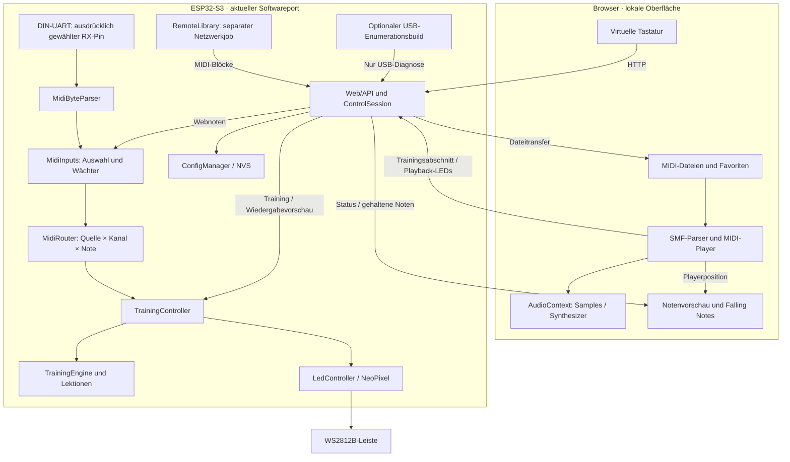
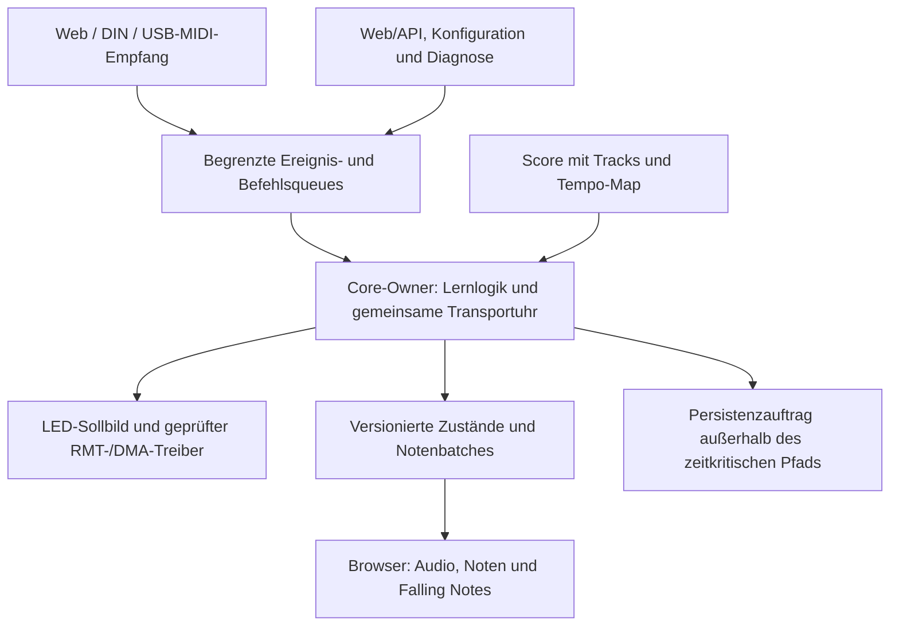

# PianoTrainer · Lernen mit Tasten, Noten und Licht

PianoTrainer hilft beim **Klavier- und Keyboardlernen**: Eine adressierbare LED-Leiste wird auf einem feststehenden Gehäuseteil direkt oberhalb der Tasten befestigt. Ihre LEDs markieren die zu spielenden Tasten. Eine lokale Weboberfläche ergänzt Lektionen, MIDI-Wiedergabe, Notenvorschau und Falling Notes – auf Desktop, Tablet und Handy.

**Urheber: [okuemmel](https://github.com/okuemmel) · Entwicklungsstand: `2.0.0-alpha.2` · Deutsch / English**

Dieses Projekt ist **vibe coded**: Es entsteht im Dialog mit einem KI-Coding-Agenten, der große Teile des Codes und der Tests erzeugt. Was tatsächlich geprüft wurde und was noch offen ist, steht im [Testplan](docs/V2_TEST_PLAN.md).


## Stand und Downloads

| Stand | Plattform | Umfang / Downloads |
|---|---|---|
| **Stabile v1: 1.15.1** | ESP32-C3 SuperMini, 4 MiB Flash | [GitHub-Release](https://github.com/okuemmel/PianoTrainer/releases/tag/v1.15.1) · [Installation und Pakete](dist/v1.15.1/INSTALLATION.md) |
| **v2: 2.0.0-alpha.2** | ESP32-S3-WROOM-1-N16R8, 16 MiB Flash / 8 MiB PSRAM | [Entwicklungsdateien](dist/v2.0.0-alpha.2/README.md) · [S3-Installation](dist/v2.0.0-alpha.2/s3_n16r8/INSTALLATION.md) |
| **C3-Regressionsbuild der v2** | ESP32-C3 SuperMini | [Separate C3-Dateien](dist/v2.0.0-alpha.2/c3_supermini/INSTALLATION.md), auch als Hilfe für den Browserdatenumzug |

Stand 1. November 2026: Der S3-Port und die vorgezogene MIDI-Vorbereitung sind gebaut und automatisiert getestet. **Das S3-Board ist noch im Zulauf; die reale Hardwareabnahme steht aus.** USB-MIDI empfängt noch keine Noten. Der getrennte USB-Probelauf ist für die spätere Geräteerkennung vorgesehen. Ein finales v2.0.0-Release gibt es noch nicht.

Die Entwicklung erfolgt für `develop/v2`, derzeit in [PR #1: S3-Port](https://github.com/okuemmel/PianoTrainer/pull/1) und [PR #2: MIDI-Vorbereitung](https://github.com/okuemmel/PianoTrainer/pull/2). Der aktuelle Implementierungsbranch ist `feature/v2-midi-inputs`; `main` enthält die stabile v1.

## Was der Trainer bietet

| Bereich | Funktionen |
|---|---|
| **Lektionen** | 20 Lektionen in vier Kapiteln, von ersten Tönen und Fingerwechseln bis zu Akkorden, Zusammenspiel und Melodien; gespeicherte Durchläufe, Bestwerte und Sterne |
| **Training** | Freies Spiel, geführtes Lernen / Wait for Note, Rhythmustraining und Song-Modus; 19 Vorlagen und eigene MIDI-Abschnitte; Tempo, Einzähler, Pause und Fortsetzen |
| **Darstellung** | Virtuelle Klaviatur mit einer zentrierten LED pro Taste, Notenvorschau im Violin-/Bassschlüssel und Canvas-Falling-Notes-Ansicht mit vergrößerter Darstellung |
| **Anhören** | Ganzen MIDI-Dateien mit lokalen Klaviersamples oder Synthesizer folgen; Lautstärke, Pause, Stopp und zehn Sekunden zurück; Noten- und LED-Anzeige während der Wiedergabe |
| **LEDs** | WS2812B, 1–300 LEDs, RGB/GRB, Helligkeit, Startoffset, umgekehrte Reihenfolge, individuelle Zuordnung aller 128 MIDI-Noten und Testanimationen |
| **Bibliothek** | Lokale MIDI-Dateien, ein festes Nextcloud-WebDAV-Verzeichnis, MIDIsss-Suche und MIDICollection; Browser-Favoriten und Speichern in Nextcloud |
| **System** | WLAN-Einrichtung, aktuelle IP-Konfiguration, Hostname/mDNS, optionale Webanmeldung, eine aktive Steuersitzung, OTA, Recovery, Geräte- und Browserbackups |
| **Sprachen** | Deutsch und Englisch zur Laufzeit umschaltbar, lokale Sprachdateien und [Erweiterungsanleitung](docs/I18N.md) |

Die Oberfläche, vorhandene Übungen, lokale Dateien, gespeicherte Favoriten und der Browserklang benötigen keinen Internetzugang. Nextcloud und die Online-Suchen sind optionale Quellen. Für Audio ist die erste bewusste Betätigung einer Wiedergabe-/Klangschaltfläche nötig.

### Tastaturumfang und LED-Zuordnung

Unter **LEDs · Aufbau & Test → Streifen & Tastatur** den Tastaturumfang wählen und speichern:

| Tasten | Bereich | MIDI-Noten |
|---|---|---|
| 49 | C3–C7 | 48–96 |
| 61 | C2–C7 | 36–96 |
| 76 | E1–G7 | 28–103 |
| 88 | A0–C8 | 21–108 |

Eigene Bereiche sind ebenfalls möglich. Die **physische LED-Anzahl separat** passend zum Streifen einstellen. Die Zuordnungstabelle enthält 128 Einträge: `-1` deaktiviert eine Note, sonst gilt `erste LED + Tabellenwert`; bei umgekehrtem Streifen wird der Index anschließend gespiegelt. Mehrere Noten können dieselbe LED verwenden. Unzugeordnete Tasten werden angezeigt.

### Üben, anhören und vorauslesen

**Training → Lektionen** empfiehlt die erste noch nicht bestandene Lektion; alle Lektionen bleiben frei wählbar. Ab 80 % gilt eine Lektion als bestanden. Ein Stern bedeutet abgeschlossen, zwei Sterne bestanden, drei Sterne mindestens 95 %. Nur abgeschlossene Lektionen werden gespeichert, eine schlechtere Wiederholung senkt den Bestwert nicht.

Geführtes Lernen wartet auf die richtige Note bzw. den vollständigen Akkord. Wiederholte Noten brauchen einen neuen Anschlag; zusätzliche gehaltene Töne verhindern einen korrekten Akkord. Rhythmustraining verwendet vier Einzählerschläge, 40–200 BPM und ein Zeitfenster von ±80 bis ±400 ms. Bewertet werden Einsätze und Timing, nicht Pedal, Dynamik oder korrekt gehaltene Notenlängen. Die bestehende Trainingsgrenze liegt bei acht gleichzeitigen Zielnoten und 128 Schritten pro Abschnitt.

Eine MIDI-Datei auswählen und entweder **Datei als Übung übernehmen** oder oben **MIDI anhören** wählen. Der Import unterstützt SMF-Format 0/1 mit PPQN, Running Status, Kanalwahl und Transposition: bis 2 MiB, 64 Spuren und 250.000 Ereignisse. Größere Stücke werden abschnittsweise geübt. Der Trainingsimport quantisiert Einsätze und verwendet ein festes Übungstempo; das Anhören erhält die Tempo-Map und Notendauern der ganzen Datei.

**Noten anzeigen · Übung & Player** zeigt den aktuellen und fünf kommende Einsätze. Es ist eine Tonhöhen-/Einsatzvorschau, keine vollständig rekonstruierte Partitur. Unter **Ansicht → Falling Notes** fallen Notenbalken auf eine proportionale Klaviatur. Die Vorschau beträgt standardmäßig vier Sekunden. Blau/Grün stehen für linke/rechte Hand anhand einer einstellbaren Trennnote, nicht anhand verifizierter MIDI-Handspuren. Pause/Fortsetzen funktioniert auch in der vergrößerten Ansicht; **10 s zurück** gilt für den Dateiplayer.

## Architektur

### Aktuell implementiert · alpha.2



`MidiInputs` und `MidiRouter` normalisieren Eingaben, bevor dieselbe bestehende Lernengine sie auswertet. Das feste Ledger unterscheidet Quelle, Kanal und Note: Ein Note-Off einer Quelle löscht keine noch gehaltene Note einer anderen. Im normalen Build ist zunächst **eine Quelle ausgewählt**, nach Neustart immer die virtuelle Tastatur. Der S3-DIN-Eingang ist optional; Parser und Treiber sind gebaut, aber noch nicht am Instrument geprüft.

Lernzustand und LED-Ansteuerung werden weiterhin im Arduino-Hauptloop verändert. `RemoteLibrary` verarbeitet Netzwerkjobs getrennt. Der USB-Probelauf hat einen SDK-Daemon; seine Client-Ereignisse werden im Loop bearbeitet. **Er übergibt noch keine USB-Noten an den Router.**

Der Dateiplayer verwendet aktuell die AudioContext-Uhr im Browser, die Lernengine die Gerätezeit. Falling Notes folgt jeweils der aktiven Quelle; Playback-LEDs werden über HTTP gespiegelt. Die gemeinsame S3-Transportuhr und eine vom WLAN unabhängige Playback-/LED-Synchronisation sind noch geplante Schritte.

### Zielbild für die nächsten Phasen · noch nicht vollständig implementiert



USB-Bulk-Empfang, Gerätegenerationen/Hotplug, MIDI-Queues, gemessene Latenzen, RMT-/DMA-Optimierung und gemeinsamer Transport werden schrittweise ergänzt. Core-Zuordnung und Taskprioritäten werden erst anhand des tatsächlichen SDK-/Hardwareverhaltens festgelegt. [Architektur, Komponenten und Entscheidungen](docs/V2_ARCHITECTURE.md) · [MIDI-Vorbereitung und Grenzen](docs/V2_MIDI_PREPARATION.md).

## Hardware und Aufbau

v2 zielt auf das vom Nutzer genannte **ESP32-S3 DevC-1-N16R8-S3**. Die Anbieterbeschreibung nennt ein WROOM-1-N16R8-Modul und zwei USB-C-Buchsen. Das Profil verwendet 16 MiB QSPI-Flash und 8 MiB OPI-PSRAM; reale Speichererkennung, Trägerplatine, Portbelegung und Hostversorgung müssen am gelieferten Board geprüft werden. Die C3-Version bleibt als stabile v1 erhalten.


Das vorhandene Schema ist ein **LED-Funktionsschema mit C3-Illustration**, kein verbindlicher S3-Pinout- oder USB-Host-Schaltplan.

| Verbindung | Anschluss / Einstellung |
|---|---|
| LED-Daten | An **DIN** der ersten LED; Standard GPIO 4, tatsächliche S3-Belegung vor Anschluss prüfen |
| Signalpegel | Vorzugsweise 74AHCT125-Pegelwandler und 330–470 Ω Serienwiderstand |
| LED-Versorgung | Geregelte externe 5 V; Netzteil und Leitungen für den konkreten Streifen dimensionieren |
| Masse | LED GND, Netzteil GND und ESP GND verbinden |
| Mechanik | Leiste auf feststehendem Gehäuseteil befestigen, Tasten frei beweglich lassen; Positionen anschließend zuordnen |

Ein WS2812B-Streifen leuchtet durch Versorgung allein nicht automatisch; er benötigt gültige Daten. Die Firmware startet mit ausgeschalteten LEDs. Nicht benötigte LEDs können unzugeordnet bleiben. [Bildquellen und Generierungsangaben](docs/images/GENERATED.md); die Aufbauansichten sind KI-generierte Illustrationen, keine Hardwarefotos oder App-Screenshots.

<details>
<summary>Montagedetail</summary>


</details>

### MIDI-Eingänge und OTraki

| Eingang | Aktueller Stand |
|---|---|
| **Virtuelle Tastatur** | Standard nach jedem Neustart; funktioniert auch ohne angeschlossenes Instrument |
| **DIN über UART** | S3-only, opt-in unter MIDI-Konfiguration mit ausdrücklich gewähltem freien RX-GPIO und separater Optokopplerschaltung; Auswahl gilt bis Neustart und pausiert laufendes Training |
| **OTraki DIN/USB-Konverter** | Vorgesehener USB-MIDI-Eingang. Zunächst Geräte-/Deskriptorprüfung im separaten Probelauf; USB-Notenempfang und Kompatibilität noch offen |

Geplanter USB-Anschluss: **Keyboard MIDI OUT → OTraki MIDI IN → geprüfter USB-Hostanschluss des S3**. Der OTraki wird nicht direkt an den UART-RX-Pin angeschlossen. Zwei USB-C-Buchsen belegen weder ihre Rollen noch eine geeignete Hostversorgung; Zuordnung, VBUS und Debugpfad werden vor dem Hardwareversuch geprüft. Der Diagnosebuild `s3_usb_probe` verwendet die UART-Konsole, startet Enumeration erst nach `U` und erstellt keine OTA-Pakete. [Probelauf und weitere Integrationsschritte](docs/V2_MIDI_PREPARATION.md#usb-stack-entscheidung-und-separater-probelauf).

## Bauen und einrichten

Voraussetzungen für die Entwicklung: **PlatformIO** (z. B. in VS Code), Python 3 und für Browser-/Werkzeugtests Node.js mit npm. Auf dem ESP läuft kein Node.js. Festgelegt sind PlatformIO `espressif32@6.10.0`, Arduino-ESP32 2.0.17 / IDF 4.4.7, NeoPixel 1.12.5 und ArduinoJson 6.21.5.

Bis zur Integration der beiden v2-PRs enthält dieser Branch die aktuelle Implementierung:

```sh
git clone --branch feature/v2-midi-inputs https://github.com/okuemmel/PianoTrainer.git
cd PianoTrainer
pio run -e s3_n16r8
pio run -e s3_n16r8 -t buildfs
python3 tools/build_release.py --board s3_n16r8
```

Die Befehle **bauen und bündeln**, sie flashen kein Gerät. Das S3-Environment verwendet `partitions_s3_n16r8.csv`: zwei OTA-Appplätze mit je 4 MiB, NVS und eine LittleFS-Partition für optionale Samples. Ergebnisse liegen in `.pio/build/s3_n16r8/` und `dist/v2.0.0-alpha.2/s3_n16r8/`. Erstinstallation und Offsets stehen in der [passenden USB-Anleitung](dist/v2.0.0-alpha.2/s3_n16r8/INSTALLATION.md). Nur die Dateien für das tatsächlich identifizierte Board verwenden.

HTML, CSS, JavaScript und Sprachdateien sind gzip-komprimiert **in der Firmware eingebettet**. Ein Dateisystemupload ist für die Oberfläche nicht erforderlich. LittleFS liefert die optionalen Klaviersamples; ohne sie steht der Browser-Synthesizer bereit. Ein `uploadfs` ersetzt den Samplebestand, ein vollständiges Flash-Erase löscht auch NVS. C3-Regressionsbuilds verwenden ausdrücklich `-e c3_supermini`, niemals das S3-Paket.

### WLAN und Zugriff

1. Mit **MIDI-Trainer-Setup** verbinden, WLAN-Passwort **`piano123`**.
2. **http://192.168.4.1/** öffnen, falls das Captive Portal nicht erscheint.
3. Unter WLAN-Einstellungen das eigene 2,4-GHz-WLAN konfigurieren; die IP-Adresse wird per DHCP vergeben. Zugangsdaten werden erst nach erfolgreicher Verbindung gespeichert.
4. Danach ins eigene WLAN wechseln und die angezeigte IP-Adresse öffnen. IP, Subnetz, Gateway, DNS, MAC, Signalstärke und Hostname stehen in den WLAN-/Systeminformationen und im seriellen Log.
5. Optional einen Hostnamen setzen; Standard `midi-trainer`, lokaler Zugriff bei verfügbarem mDNS über **http://midi-trainer.local/**. DDNS und statische IPv4-Konfiguration sind nicht implementiert.

**Die Webanmeldung ist standardmäßig ausgeschaltet.** Unter System lässt sie sich aktivieren; Benutzer ist `admin`, Anfangspasswort `admin`, sofern nicht geändert. Setup-WLAN-Passwort und Webpasswort sind getrennte Zugangsdaten. Es gibt eine aktive Steuersitzung pro Gerät: Ein anderer Browser/Tab muss die Sitzung ausdrücklich übernehmen. Der verdrängte Browser kann sie nicht automatisch zurückfordern; nach 30 Sekunden ohne Lebenszeichen läuft eine Sitzung aus.

### Erster LED-Test und Logs

Unter **LEDs · Aufbau & Test** mit geringer Helligkeit den kurzen RGB-Test der ersten LED starten, danach Anzahl, RGB/GRB und Zuordnung einstellen. Die virtuelle LED-Leiste zeigt den tatsächlichen Geräte-Ausgabepuffer; sie ist keine Messung des elektrischen Signals.

Der serielle Monitor arbeitet mit **115200 Baud**. `t` startet den RGB-Test, `x` schaltet die LEDs aus. Das Bootlog nennt Board und Speicher, weitere Logs zeigen WLAN- und HTTP-Zustände. Bei dunklem Streifen zuerst DIN/DOUT-Richtung, gemeinsame Masse, Versorgung, Datenpegel und gewählten GPIO prüfen.

Werksreset unter System mit **WERKSRESET**, alternativ **BOOT im laufenden Betrieb acht Sekunden halten**: S3 GPIO 0, C3 GPIO 9. Dadurch gehen Einstellungen und Lernfortschritt verloren; die Webanmeldung ist danach wieder ausgeschaltet.

## MIDI-Bibliothek, Klang und Datensicherung

**Nextcloud:** Unter Import-Einstellungen die vollständige WebDAV-Ordneradresse, Benutzer und App-Passwort hinterlegen. Training listet die enthaltenen MIDI-Dateien; **In Nextcloud speichern** legt ausgewählte Dateien dort ab. Vorhandene Dateien werden nicht überschrieben. Uploads verwenden eine eindeutige temporäre `.tmp`-Datei und WebDAV-MOVE zum endgültigen Namen. HTTPS-Zertifikate werden geprüft, optional mit eigener öffentlicher CA.

**Onlinequellen:** MIDIsss und MIDICollection verwenden denselben Importer/Player wie lokale Dateien. MIDICollection ist eine HTML-Anbindung und kann bei Änderungen der Quellseite Anpassungen benötigen. Netzwerkdateien werden blockweise über einen einzelnen Gerätejob weitergereicht, nicht vollständig im Geräte-RAM oder Flash gespeichert.

**Favoriten:** Vollständige MIDI-Dateien bleiben in IndexedDB des aktuellen Browsers gespeichert, bis zu 32 Dateien mit insgesamt 32 MiB und 2 MiB pro Datei. Browser, Adresse und Protokoll bestimmen den Speicherbereich. Ein Geräte- oder Hostnamenwechsel überträgt diese Daten nicht automatisch.

**Klang:** Player und virtuelle Tasten verwenden ein lokales Paket mit 16 Klaviersamples und Synthesizer-Fallback. Es ist keine vollständige MIDI-Instrumentenbibliothek; Programmwechsel, Pedal und Saitenresonanzen werden nicht nachgebildet. [Samplequellen und Lizenzhinweise](data/piano-credits.txt).

### Updates und Backups

| Datei / Funktion | Inhalt und Verhalten |
|---|---|
| **`firmware.ptupdate`** | Firmware, Oberfläche und Sprachen gemeinsam; über System hochladen. Chip, Layout, Länge und MD5 werden geprüft. Einstellungen und vorhandene Samples bleiben erhalten. |
| **`littlefs.ptupdate`** | Optionaler Sample-/Dateisystembestand; ersetzt eine einzelne Dateisystemkopie. Unterbrechungen können einen erneuten Upload erfordern. |
| **Gerätebackup `.json`** | LED-/Tastaturdaten, Mapping, Kanalfilter, Hostname, öffentliche Nextcloud-Konfiguration und Lektionsergebnisse; Format/schema 1, maximal 16 KiB. |
| **Browserbackup `.ptbrowser`** | Volle MIDI-Favoriten und lokale Ansichtseinstellungen; binärer Export mit Dateiprüfsummen, atomarer Zusammenführung der Favoriten beim Import. |
| **`/recovery`** | Kleiner Firmwareuploader, ebenfalls in Firmware eingebettet; verfügbar, solange die Anwendung läuft. |

WLAN, Webanmeldung und Passwörter werden nicht im öffentlichen Gerätebackup exportiert. Bei einem Gerätewechsel auf dem neuen Trainer neu einrichten. Ein alter GPIO wird vor Restore geprüft; gesperrte Pins erfordern eine bewusste Neuauswahl. Die Quellenauswahl Web/DIN ist flüchtig und wird nicht gesichert. [Vollständiger C3→S3-Migrationsweg](docs/V2_S3_PORT.md#datenumzug-vom-c3).

Die Downloadverzeichnisse enthalten getrennte Chipziele, USB-Installationspakete, Anleitungen und SHA-256-Prüfsummen. Ein unvollständiger Firmwareupload aktiviert den neuen OTA-Slot nicht; eine automatische Rückkehr nach jedem Fehler beim Start neuer Firmware ist nicht zugesichert. Ein Update über eine externe URL ist noch nicht implementiert.

## Entwickeln, prüfen und mitarbeiten

```sh
npm ci --ignore-scripts
npm test
npm run format:check
python3 -m unittest discover -s test -p test_tools.py
pio test -e native -e native_s3
pio run -e s3_n16r8 -e c3_supermini -e s3_usb_probe
pio run -e s3_n16r8 -e c3_supermini -t buildfs
```

Prüfstand für alpha.2: **91 Node-, 68 native und 7 Python-Tests bestanden**, dazu die drei Firmwarebuilds und beide normalen LittleFS-Builds. Das sind Host-/Buildnachweise, keine S3-Hardware-, OTraki-Kompatibilitäts- oder Latenzabnahme. Der [Testplan](docs/V2_TEST_PLAN.md) enthält genaue Ergebnisse und sämtliche offenen Hardwarefälle; [TESTING.md](TESTING.md) bewahrt die historischen C3-Nachweise.

| Komponente | Quellcode / Dokumentation |
|---|---|
| Board und Build | [BoardProfile.h](include/BoardProfile.h), [platformio.ini](platformio.ini), [S3-Partitionen](partitions_s3_n16r8.csv) |
| Eingaben und Protokolle | [MidiTypes.h](include/MidiTypes.h), [MidiInput.h](include/MidiInput.h), [MidiRouter.h](include/MidiRouter.h), [MidiByteParser.h](include/MidiByteParser.h), [UsbMidiProtocol.h](include/UsbMidiProtocol.h) |
| Lernen und LEDs | [TrainingEngine.h](include/TrainingEngine.h), [TrainingController.cpp](src/TrainingController.cpp), [LedController.cpp](src/LedController.cpp), [LessonCatalog.h](include/LessonCatalog.h) |
| API, Daten und Netzwerk | [TrainerWebServer.cpp](src/TrainerWebServer.cpp), [ConfigManager.cpp](src/ConfigManager.cpp), [RemoteLibrary.cpp](src/RemoteLibrary.cpp), [WiFiManager.cpp](src/WiFiManager.cpp) |
| Browser | [app.js](data/app.js), [midi-player.js](data/midi-player.js), [falling-notes.js](data/falling-notes.js), [Sprachdateien](data/i18n/languages.json) |
| Architektur und Migration | [Architekturentscheidungen](docs/V2_ARCHITECTURE.md), [Feature-Parität](docs/V2_FEATURE_PARITY.md), [Migrationsplan](docs/V2_MIGRATION_PLAN.md), [MIDI-Vorbereitung](docs/V2_MIDI_PREPARATION.md) |

`main` bleibt stabil; v2 wird über Featurebranches und Pull Requests für `develop/v2` entwickelt. [AGENTS.md](AGENTS.md) beschreibt die Arbeitsregeln. [CHANGELOG.md](CHANGELOG.md) wird bei sichtbaren Änderungen im selben Commit mitgeführt. Projektversion, Urheber und Repository-Link stammen aus [AppInfo.h](include/AppInfo.h).

Es ist noch keine projektweite LICENSE-Datei festgelegt. Die Hinweise zu Fremdassets in [piano-credits.txt](data/piano-credits.txt) und den [Bildquellen](docs/images/GENERATED.md) gelten unabhängig davon.
