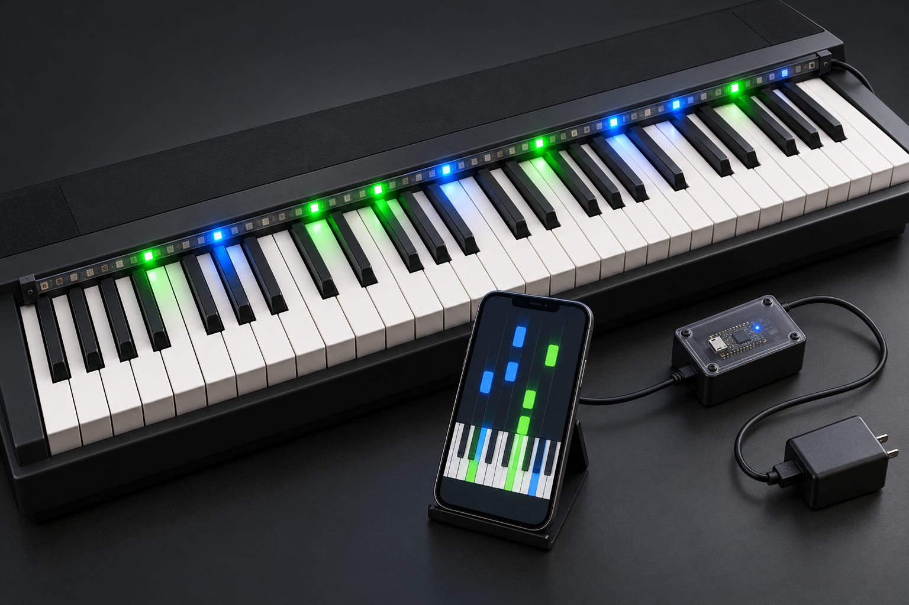
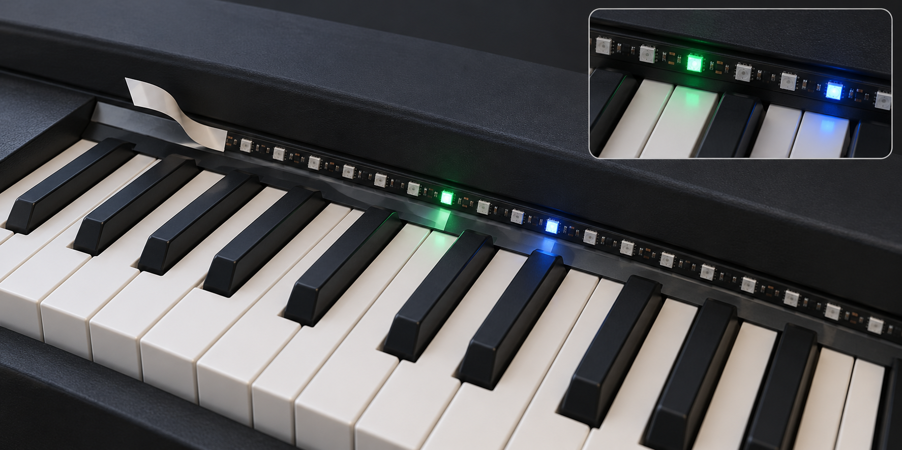
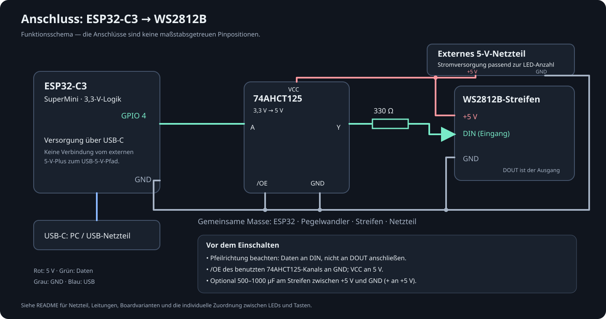

# MIDI LED Piano Trainer · ESP32-C3 SuperMini

Dieses Projekt ist **vibe coded**: Es entsteht im Dialog mit einem KI-Coding-Agenten, der große Teile des Codes und der Tests erzeugt. Die dokumentierten Prüfungen zeigen, was tatsächlich getestet wurde; sie ersetzen keine vollständige Erprobung am Instrument.

Der Trainer soll dabei helfen, **Klavier oder Keyboard zu lernen**. Dazu wird eine LED-Leiste auf das Keyboard beziehungsweise Klavier geklebt und so ausgerichtet, dass die LEDs die zugehörigen Tasten markieren. Bei Übungen und MIDI-Stücken zeigen die LEDs an, welche Tasten als Nächstes gespielt werden sollen. Die optionale Notenansicht hilft zusätzlich beim Notenlesen. Die aktuelle C3-Version verwendet simulierte MIDI-Eingaben über die virtuelle Tastatur; die Anbindung eines echten Instruments ist eine spätere Erweiterung.

Phase 1 plus Trainingsmodi mit simuliertem MIDI für ein **ESP32-C3 SuperMini mit 4 MB Flash** und einen WS2812B-Streifen. Die Firmware bietet WLAN-Einrichtung, lokale deutsche Weboberfläche, persistente LED-Konfiguration, Animationen und eine virtuelle, mehrstimmige MIDI-Tastatur. Für Phase 1 wird kein MIDI-Kabel benötigt.

## Aufbau am Keyboard



Die Leiste auf einem **feststehenden Gehäuseteil direkt oberhalb der Tasten** befestigen, sodass alle Tasten frei beweglich bleiben. Eine ablösbare Schutz-/Klebeschicht verwenden und die Positionen danach in der LED-Zuordnung kalibrieren. Nicht benötigte LEDs können unzugeordnet bleiben. Die Bilder sind KI-generierte Aufbauillustrationen; die Telefonansicht ist symbolisch und kein Screenshot.

<details>
<summary>Montagedetail anzeigen</summary>



</details>

## Hardware anschließen



Das Schema zeigt die elektrischen Verbindungen, keine maßstabsgetreue Pinbelegung. [Bildquellen und verwendete Generierungs-Prompts](docs/images/GENERATED.md).

| Verbindung | Anschluss |
|---|---|
| LED DIN (Eingangsseite / Pfeilrichtung beachten) | GPIO **4**, vorzugsweise über 74AHCT125-Pegelwandler und 330–470 Ω Serienwiderstand |
| LED +5 V | Externes geregeltes 5-V-Netzteil |
| LED GND, Netzteil GND, ESP GND | Gemeinsame Masse |
| ESP USB-C | PC zum Programmieren und zur Versorgung des ESP |

60 klassische WS2812B können bei voller weißer Helligkeit bis ca. 3,6 A benötigen; Netzteil und Leitungen passend dimensionieren (z. B. 5 V / 4 A oder größer). Standardhelligkeit ist 25 %, die Software ist jedoch kein Überstromschutz. 500–1000 µF zwischen 5 V und GND nahe am Streifen sind sinnvoll. LED-Streifen nicht über den 3,3-V-Ausgang versorgen. Externe 5 V nicht gleichzeitig unkontrolliert auf den USB-5-V-Pfad des Boards einspeisen. Boardvarianten unterscheiden sich beim Rückspeiseschutz. 3,3-V-Daten direkt an einem 5-V-Streifen sind nicht für alle WS2812B zuverlässig; der Pegelwandler sorgt für einen passenden Logikpegel.

Die konservative GPIO-Freigabe lautet **0, 1, 3, 4, 5, 6, 7, 10, 20, 21**. GPIO 2/8/9 sind Boot-Strapping-Pins, GPIO 8 ist auf üblichen SuperMinis mit der Board-LED verbunden, GPIO 9 mit BOOT. GPIO 18/19 gehören zu USB Serial/JTAG. Flash-Pins sind ebenfalls ausgeschlossen. GPIO 4 wird ausschließlich als LED-Ausgang verwendet; externes JTAG auf diesem Pin darf nicht parallel angeschlossen sein.

Das generische PlatformIO-Profil `esp32-c3-devkitm-1` bildet CPU und 4-MB-Flash ab. Die Umgebung `c3_supermini` ergänzt **native USB-CDC**, DIO-Flash-Modus und ein eigenes LittleFS-Partitionslayout. Es wird keine externe UART-USB-Brücke vorausgesetzt. Vor dem Upload überprüfen, ob dein konkreter SuperMini tatsächlich 4 MB Flash besitzt.

## Installation und Kompilierung

1. [Visual Studio Code](https://code.visualstudio.com/) installieren.
2. In VS Code die Erweiterung **PlatformIO IDE** von PlatformIO installieren. Die C/C++-Erweiterung von Microsoft ist für Navigation hilfreich; Compiler und Python-Umgebung verwaltet PlatformIO.
3. Diesen Projektordner in VS Code öffnen. PlatformIO lädt beim ersten Build Plattform, Compiler und Bibliotheken herunter.
4. Über die PlatformIO-Seitenleiste → Project Tasks → **c3_supermini → General → Build** kompilieren.

Alternativ im **PlatformIO-Terminal**:

```sh
pio run -e c3_supermini
```

Es sind ESP32-Plattform `6.10.0` (Arduino-ESP32 2.0.17), Adafruit NeoPixel `1.12.5` und ArduinoJson `6.21.5` festgelegt. WLAN, synchroner WebServer, DNS, Preferences und LittleFS stammen aus dem Arduino-Core. Die NeoPixel-Bibliothek unterstützt ESP32 einschließlich der C3-RMT-Ausgabe; der vollständige C3-Build überprüft die konkrete Kombination.

## Firmware und Webdateien hochladen

1. Board mit einem **USB-Datenkabel** anschließen.
2. PlatformIO → c3_supermini → General → **Upload**.
3. PlatformIO → c3_supermini → Platform → **Upload Filesystem Image**. Dies ist zwingend erforderlich: HTML, CSS und JavaScript liegen in LittleFS.
4. PlatformIO → General → **Monitor** bei 115200 Baud öffnen. Nach dem Upload ggf. RESET drücken.

```sh
pio run -e c3_supermini -t upload
pio run -e c3_supermini -t uploadfs
pio device monitor -b 115200
```

Falls mehrere Geräte angeschlossen sind, `--upload-port /dev/cu.usbmodem…` ergänzen beziehungsweise `upload_port` und `monitor_port` in `platformio.ini` setzen. Unter Windows heißt der Anschluss z. B. `COM5`.

Wenn kein Port erscheint: BOOT gedrückt halten, RESET kurz drücken, BOOT loslassen und erneut hochladen. Nach dem ersten Flash ggf. RESET drücken und den USB-Port neu auswählen. BOOT beim Einschalten versetzt den Chip in den Bootloader; der unten beschriebene Werksreset erfolgt dagegen im laufenden Betrieb.

LittleFS wird bei Mountfehlern **nicht automatisch formatiert**. Die HTTP-Antwort weist dann auf `uploadfs` hin. Der Upload des Dateisystems ersetzt die Webdateien; NVS bleibt im normalen Uploadablauf erhalten. Ein vollständiges Flash-Erase löscht auch Einstellungen und Passwort.

## Erstes WLAN einrichten

1. Die Webanmeldung lautet standardmäßig **Benutzer `admin`, Passwort `admin`**. Diese Vorgabe wird beim ersten Start dieser Firmware auch auf dem bereits eingerichteten Gerät gesetzt. Spätere eigene Passwortänderungen bleiben über Neustarts erhalten.
2. Auf Smartphone/iPad/PC mit **MIDI-Trainer-Setup** verbinden. Das Setup-WLAN-Passwort lautet dauerhaft **`piano123`**, auch nach einem Werksreset.
3. Ein Captive Portal kann automatisch erscheinen. Andernfalls **http://192.168.4.1/** im Browser öffnen. Die Systemmeldung „kein Internet“ ist bei diesem lokalen AP normal.
4. Mit Benutzer `admin` und Passwort `admin` anmelden (sofern nicht selbst geändert). Unter WLAN-Einstellungen Netzwerke suchen oder SSID manuell eingeben. Nur 2,4 GHz; unterstützt werden offene Netzwerke und persönliche WPA/WPA2-Netze, kein Enterprise-Login.
5. WLAN-Passwort eingeben und Verbindung testen. Der Test blockiert den Hauptloop nicht und endet spätestens nach 15 Sekunden. Zugangsdaten werden erst nach erfolgreicher Verbindung als gemeinsamer NVS-Datensatz gespeichert.
6. Die neue IP-Adresse erscheint auf dem Dashboard/Systemseite und im seriellen Monitor. Der Setup-AP bleibt nach erfolgreicher Verbindung noch 30 Sekunden aktiv. Danach zum Heim-WLAN wechseln und **http://GERÄTE-IP/** öffnen. Bei einem Wechsel des AP-Kanals während Scan/Verbindungsaufbau kann eine erneute Verbindung zum Setup-AP nötig sein.

Ist das gespeicherte WLAN beim Start nicht erreichbar oder geht eine bestehende Verbindung länger verloren, öffnet sich nach dem begrenzten Verbindungsversuch wieder der Setup-AP. Die Weboberfläche bietet außerdem „Setup-AP einschalten“. Bei fehlgeschlagenem Wechsel bleiben die vorherigen gespeicherten Zugangsdaten erhalten; sie werden nach einem Neustart erneut versucht. Eine Verbindung ohne Internet ist ausreichend.

## WLAN-Diagnose am C3 SuperMini

Der serielle Monitor läuft mit 115200 Baud. Nach RESET zeigt er AP-Start, den tatsächlich gesetzten Authentifizierungsmodus, eine Passwortprüfung ohne Passwortausgabe und die Sendeleistung. Beim Verbinden eines Telefons werden Anmeldung (`Gerät am Setup-AP angemeldet`), DHCP-Adressvergabe und Trennung protokolliert. Router-Verbindungsabbrüche enthalten zusätzlich den numerischen Grundcode. Der verwendete IDF-4.4-Core liefert für AP-Client-Trennungen keinen solchen Grundcode.

Zur Eingrenzung der gemeldeten iPhone/iPad-Verbindungsprobleme ist die Sendeleistung versuchsweise auf **8,5 dBm** begrenzt und WLAN-Modem-Sleep deaktiviert (`configureRadio()` in `src/WiFiManager.cpp`). Das ist ein Diagnoseversuch, keine bestätigte Fehlerursache. Bei größerer Entfernung kann die reduzierte Leistung die Reichweite verringern. Die WLAN-Ereignisse und Energieeinstellungen sind in der [Espressif-C3-Dokumentation](https://docs.espressif.com/projects/esp-idf/en/v4.4.5/esp32c3/api-guides/wifi.html) beschrieben.

## Webserver-Log lesen

Beim Start prüft die Firmware die lokalen Webdateien mit Dateigröße und meldet den HTTP-Start auf Port 80. Beim Öffnen der Oberfläche erscheinen `[HTTP]`-Zeilen:

- `200`: HTML, CSS oder JavaScript wurden gesendet; die Bytezahlen zeigen den übertragenen Umfang.
- `401, Webanmeldung erforderlich`: Der Browser muss sich mit `admin` und dem seriell ausgegebenen Gerätepasswort anmelden.
- `401, Webanmeldung fehlgeschlagen`: Anmeldedaten fehlen oder stimmen nicht. Das Setup-WLAN-Passwort `piano123` ist von der Webanmeldung unabhängig.
- `302`: Ein unbekannter Pfad (z. B. die automatische iOS-Captive-Portal-Prüfung) wird zur Startseite umgeleitet.
- `503`: Eine benötigte Webdatei fehlt oder lässt sich nicht öffnen; LittleFS-Upload beziehungsweise Dateisystem prüfen.

Die Arduino-Core-Meldung `request handler not found` erscheint vor dem eigenen `onNotFound`-Handler auch bei einer anschließend regulär beantworteten Weiterleitung. Die folgende `[HTTP]`-Zeile zeigt den tatsächlich gewählten Antwortcode. Passwörter und Authorization-Header werden nicht geloggt.

## LEDs testen und zuordnen

1. Mit Standardwerten beginnen: 60 LEDs, GPIO 4, GRB, 25 % Helligkeit, erste LED 0, 49 Tasten.
2. Unter LED-Steuerung LED-Index **0** wählen und mit niedriger Helligkeit testen. Danach Rot, Grün und Blau einzeln prüfen; bei vertauschten Farben die Farbreihenfolge ändern.
3. „LEDs nacheinander“ durchläuft den Streifen einmal und schaltet ihn anschließend aus. „Lauflicht“, „Rot/Grün/Blau/Weiß“ und „Helligkeitsrampe“ laufen bis zum Stoppen. Die Rampe überschreitet die konfigurierte Helligkeit nicht.
4. Auf dem Dashboard virtuelle Tasten halten. Mehrere Finger erzeugen gleichzeitige Noten; Loslassen sendet Note Off. Die Velocity wird unter MIDI-Konfiguration eingestellt. „Alle Noten loslassen“ oder „Alles ausschalten“ beendet die Ausgabe.
5. Unter LED-Konfiguration die mechanische Zuordnung anpassen und speichern. Indizes beginnen bei **0**. Die Tabelle enthält alle 128 MIDI-Noten. `-1` deaktiviert eine Note. Sonst gilt `logischer Index = erste LED + Tabellenwert`; Umkehrung ergibt `LED-Anzahl − 1 − logischer Index`. Bei gemeinsam genutzten LEDs gewinnt die höchste aktive Velocity.
6. „Fortlaufend zuordnen“ erzeugt die Zuordnung neu anhand von erster MIDI-Note, Tastenanzahl und Platz auf dem Streifen; anschließend speichern. Die Startnote ist zunächst **48 (C3, MIDI-Namenskonvention C4=60)** und bis 96 reichen die 49 virtuellen Tasten. Den tatsächlichen Bereich des Yamaha vor späterer Hardware-MIDI-Nutzung prüfen und bei Bedarf anpassen.

Der MIDI-Kanalfilter ist persistent (0 = alle, 1–16 = ausgewählter Kanal). Der Sendekanal und die virtuelle Anschlagstärke sind browserlokale Bedienwerte. Die Tastatur nutzt geordnete HTTP-Befehle und einen Heartbeat; nach 3 Sekunden ohne Heartbeat/Notenereignis werden virtuelle Noten freigegeben. Statusdaten werden alle 2 Sekunden abgefragt, ohne Seitenreload. Mehrere Browser steuern denselben gemeinsamen Gerätezustand; getrennte Spielsessions sind nicht vorgesehen.

## Wenn keine LED leuchtet

Ein WS2812B-Streifen schaltet seine LEDs durch Versorgung allein nicht zuverlässig ein. Er benötigt gültige Farbdaten; die Firmware sendet beim Start bewusst „Aus“. Bei 5-V-Versorgung kann ein direktes 3,3-V-Datensignal je nach LED-Variante nicht ausreichen. Den Signalpegel mit einem für 3,3-V-Eingänge geeigneten 5-V-Puffer wie 74AHCT125 anpassen; gemeinsame Masse und Anschluss an **DIN** der ersten LED sind nötig. Siehe [Adafruit: Basic Connections](https://learn.adafruit.com/adafruit-neopixel-uberguide/basic-connections).

Unter LED-Steuerung gibt es „Erste LED: kurzer RGB-Test“. Dieser Test nutzt den physischen Index 0, unabhängig vom MIDI-Mapping, zeigt nacheinander Rot/Grün/Blau bei höchstens 10 % Helligkeit und schaltet nach etwa 3 Sekunden aus. Die konfigurierte Helligkeit wird danach wiederhergestellt.

Um die Weboberfläche als Fehlerquelle auszuschließen, kann derselbe Test im seriellen Monitor durch Senden von **`t`** gestartet werden; **`x`** schaltet aus. Der Hauptloop läuft währenddessen weiter. Das Startlog nennt GPIO, LED-Anzahl, Farbfolge und Helligkeit. Angenommene Webbefehle und API-Fehler werden ebenfalls protokolliert; die Oberfläche zeigt die Annahme oder Ablehnung eines LED-Befehls direkt an. Ein Logeintrag bestätigt den ausgeführten Softwarepfad, nicht den elektrischen Signalpegel oder sichtbares Leuchten.

Nach erfolgreichem WLAN-Wechsel zeigt das WLAN-Formular die neue Geräteadresse als anklickbaren Link, sobald die nächste Statusabfrage erfolgreich ist. Die Adresse bleibt im geöffneten Dokument sichtbar, wenn danach die Verbindung zum Setup-AP abbricht.

## Zugriff und Reset

Alle Webdateien und regulären API-Endpunkte erfordern HTTP-Basic-Authentifizierung. Schreibzugriffe verlangen zusätzlich einen eigenen Request-Header; CORS wird nicht aktiviert. Das Gerätepasswort lässt sich in Systeminformationen ändern (12–63 druckbare ASCII-Zeichen ohne Leerzeichen). Danach startet das Gerät neu. Das Setup-WLAN-Passwort bleibt unabhängig davon immer `piano123`.

WLAN-Passwort und Gerätepasswort werden nie über eine API zurückgegeben. WLAN-Passwörter werden nicht protokolliert. Das Gerätepasswort wird bewusst seriell ausgegeben, damit die lokale Ersteinrichtung möglich ist. NVS und HTTP sind in diesem lokalen Prototyp unverschlüsselt: ausschließlich in einem vertrauenswürdigen lokalen Netz nutzen und keine Portweiterleitung ins Internet einrichten.

Werkseinstellungen sind über Systeminformationen mit der Bestätigung **WERKSRESET** möglich. Alternativ **BOOT im laufenden Betrieb mindestens 8 Sekunden halten**. Anschließend werden alle Einstellungen gelöscht und die Webanmeldung auf `admin` / `admin` zurückgesetzt.

## Aufbau und spätere Erweiterung

```text
include/BoardProfile.h      Boardname und geeignete GPIO-Pins
include/TrainerLogic.h      Portable Konfiguration, Validierung, Notenmapping, Lernmodi
src/ConfigManager.cpp      NVS, strikte JSON-Validierung, sichere API-Repräsentation
src/WiFiManager.cpp        AP, Captive-DNS, asynchroner Verbindungszustand
src/LedController.cpp      WS2812B, millis-Animationen, mehrstimmige Noten
include/MidiInput.h        Eingangsschnittstelle und Simulation
src/TrainerWebServer.cpp   Authentifizierung, REST-API, LittleFS-Dateien
src/main.cpp               Initialisierung, Hauptloop, BOOT-Werksreset
data/                      Lokale deutsche Weboberfläche ohne CDN
test/test_logic/           Native C++-Tests
test/web.test.cjs          DOM-Integrationstests der Browserlogik
test/test_training/       Portable Trainings- und Timing-Tests
test/midi-file.test.cjs    Tests des lokalen MIDI-Importers
```

Der synchrone Arduino-Webserver verarbeitet kurze HTTP-Befehle; Animationen, DNS und WLAN-Zustände werden kooperativ im Hauptloop bedient. Ein einzelnes NeoPixel-`show()` benötigt physikalisch etwa 30 µs pro LED (bei maximal 300 LEDs ca. 9 ms), ohne lange Animationsschleifen. Langsame/gestörte HTTP-Clients können den synchronen Server dennoch zeitweise aufhalten.

Für den ESP32-S3 später ein eigenes Boardprofil und PlatformIO-Environment anlegen, Pins und Partitionierung anpassen und einen USB-Host-Eingang als `MidiInput` ergänzen. `MidiEvent` läuft über `TrainingController` in dieselbe Auswertung und LED-Darstellung. C3 hat keinen entsprechenden USB-Host-OTG. Echtes USB-MIDI und allgemeine Akkordnamenerkennung sind weiterhin nicht implementiert.

## Training mit simuliertem MIDI (Firmware 1.1)

1. Nach Firmware- und LittleFS-Upload die Browserseite neu laden und **Training** öffnen. Es wird dieselbe 49-Tasten-Tastatur wie auf dem Dashboard verwendet.
2. Modus und Übung wählen. Die Grundnote ist standardmäßig C4 / MIDI 60 bei der 49-Tasten-Konfiguration; sie lässt sich passend zum eigenen Tastenbereich ändern. Alle Zielnoten müssen innerhalb des konfigurierten Bereichs liegen und einer LED zugeordnet sein.
3. **Geführtes Lernen** wartet auf die richtige Note beziehungsweise den vollständigen Akkord. Blau zeigt das nächste Ziel, Grün gespielte Tasten und Rot eine falsche Taste. Wiederholte Noten müssen neu angeschlagen werden; gehaltene Tasten zählen nicht mehrfach. Für Akkorde alle Zielnoten gleichzeitig halten und beim nächsten Einsatz erneut anschlagen.
4. **Rhythmustraining** zählt vier Viertelschläge ein und bewertet die Anschläge bei 40–200 BPM im einstellbaren Fenster von ±80 bis ±400 ms. Zu frühe/falsche Tasten und verpasste Einsätze werden gezählt. Die Anzeige und die Ziel-LEDs geben einen optischen Takt vor. Es werden keine Klaviertöne oder Klickgeräusche abgespielt.
5. **Song-Modus** bietet dieselbe schrittweise Spielweise oder zeitgesteuertes Spielen mit Einzähler. Eingebaut sind Fünf-Finger-Übung, Dur-Tonleiter, Dur-Akkorde, Viertel/Achtel, „Freude, schöner Götterfunken“ und „Morgen kommt der Weihnachtsmann“.
6. Die Auswertung zeigt Fortschritt, richtige Einsätze, Fehler, verpasste Einsätze, Trefferquote und mittlere absolute Timing-Abweichung. Trefferquote = richtig / (richtig + falsch + verpasst). Es werden Anschläge bewertet, nicht Notenlängen, Pedal oder Anschlagsdynamik.
7. **Pause / Fortsetzen** erhält Position und Auswertung; Pausenzeit verschiebt die zeitlichen Ziele entsprechend. Beim Verlassen des Trainingsbereichs oder Fokusverlust pausiert die Oberfläche. Ohne Heartbeat oder MIDI-Ereignisse pausiert der ESP nach etwa drei Sekunden und gibt gehaltene Noten frei.
8. **Stoppen & freies Spiel** beendet das Training. Auf dem Dashboard kann freies Spiel ebenfalls ausdrücklich aktiviert werden. LED-Testprogramme und Änderungen der LED-Konfiguration beenden eine laufende Übung.

Die Zeitwertung verwendet den Empfangszeitpunkt am ESP32. WLAN- und Browserlatenz fließen damit in das Ergebnis ein; für die Simulation ist ein großzügiges Zeitfenster sinnvoll. Pro Gerät gibt es einen gemeinsamen Trainingszustand; mehrere Browser sind keine unabhängigen Spieler. Übungen und Ergebnisse liegen im RAM und werden bei Neustart verworfen.

### Virtuelle LED-Leiste und Töne (Firmware 1.2.0)

Über jeder weißen und schwarzen Taste befindet sich genau eine virtuelle LED-Anzeige, jeweils in der Tastenmitte. Tastatur und LEDs scrollen gemeinsam. Nicht zugeordnete Tasten zeigen „–“; nicht auf die sichtbare Tastatur abgebildete Streifen-LEDs werden hier nicht angezeigt. Bei gemeinsam genutzten LEDs zeigen mehrere Tasten denselben physischen LED-Pufferwert. Die Leiste zeigt die physischen LED-Indizes ab 0 und die vom ESP32 berechneten Farben. Zielnoten, gespielte Noten, Fehler und Testfarben werden aus dem aktuellen, bereits helligkeitsskalierten Ausgabepuffer übernommen. GRB/RGB wird für die Anzeige in RGB umgerechnet. Zur besseren Sichtbarkeit ist die Bildschirmdarstellung aufgehellt; sie ist keine Messung des elektrischen Signals oder der tatsächlichen Leuchtstärke.

Die LED-Beschreibungen enthalten die zugehörigen MIDI-Noten. Startoffset, umgekehrte Reihenfolge und mehrfach zugeordnete Noten werden berücksichtigt. Die Vorschau unterstützt 1–300 LEDs und wandert mit der Tastatur zwischen Dashboard und Training. Antworten auf MIDI-, Trainings-, Konfigurations- und LED-Befehle enthalten den aktuellen Farbzustand, sodass Tasteneingaben unmittelbar aktualisiert werden. Weitere Änderungen werden über die Statusabfrage abgeglichen; kurze Taktimpulse können zwischen zwei Abfragen liegen.

Die API liefert unter `leds` Anzahl, GPIO, Ausgabehelligkeit und `frame` als sechs RGB-Hexzeichen pro LED. Maximal werden 1.800 Farbzeichen pro Snapshot übertragen. Dieser Zustand wird aus dem Puffer gelesen und nicht unabhängig im Browser nachgebildet.

### Eigene MIDI-Datei

Unter Training eine `.mid`/`.midi`-Datei wählen, Importkanal und bei Bedarf Transposition einstellen, dann **Datei als Übung übernehmen**. Anschließend oben die importierte Übung starten. Der Import läuft vollständig lokal im Browser; die Rohdatei wird nicht auf den ESP hochgeladen oder persistent gespeichert.

Unterstützt werden Standard-MIDI-Dateien **Format 0 und 1**, PPQN-Zeitbasis, Running Status, Note On/Off und gleichzeitig angeschlagene Noten aus mehreren Spuren. Grenzen: 2 MiB, 64 Spuren und 250.000 Ereignisse im Browser. Große Dateien werden in wählbaren Abschnitten von maximal 128 Einsätzen mit acht gleichzeitigen Noten geübt; nur der Abschnitt wird an den C3 gesendet. „Abschnitt ab Einsatz“ ist 1-basiert (1, 129, 257 usw.); nach Ändern erneut übernehmen und oben starten. Die Gesamtzahl wird angezeigt. Lange Pausen werden in zulässige Pausenschritte aufgeteilt und zählen mit. Standardmäßig werden Noten außerhalb des konfigurierten Tastaturbereichs ausgelassen und gezählt. Der Filter ist abschaltbar; dann kann der ESP32 nicht spielbare Übungen ablehnen. Noteneinsätze werden auf ein 1/32-Notenraster gerundet, um versetzte Anschläge zusammenzufassen und den Mindestabstand der Trainingsengine einzuhalten; die musikalische Feinzeit wird dadurch vereinfacht. Kanal 0 importiert alle Kanäle außer Schlagzeugkanal 10; ein einzelner Kanal kann gezielt ausgewählt werden. SMPTE-Zeitbasis und Format 2 werden mit einer verständlichen Meldung abgewiesen.

Der Import erzeugt Übungen aus den Note-On-Einsätzen. Gehaltene Begleitnoten, Pedal und Note-Off-Dauern werden nicht als eigene Aufgaben ausgewertet. Vorlauf wird entfernt und durch den Trainings-Einzähler ersetzt. Einsätze dürfen 1/8 bis 16 Viertelschläge auseinanderliegen; Tempoänderungen werden bewusst auf das gewählte feste Übungstempo vereinheitlicht. Umfangreiche Stücke direkt im Import über den Start-Einsatz abschnittsweise üben. [MIDI Association: Standard MIDI Files](https://midi.org/standard-midi-files).

Die portable Zustandsmaschine liegt in `include/TrainingEngine.h`, die eingebauten Übungen in `include/TrainingCatalog.h`, die LED-/Zeit-Anbindung in `TrainingController` und der Importer in `data/midi-file.js`. `GET /api/training` liefert Zustand und Übungskatalog; `POST /api/training` verarbeitet `start`, `pause`, `resume`, `free` und `stop` mit derselben Authentifizierung wie die übrige API. MIDI-Antworten und `/api/status` enthalten den aktuellen Trainingszustand.

## Prüfungen

```sh
pio test -e native
pio run -e c3_supermini
pio run -e c3_supermini -t buildfs
npm ci --ignore-scripts
npm test
node --check data/app.js
```

`npm` und jsdom sind ausschließlich für Entwicklertests nötig; auf dem ESP läuft kein Node.js. Die nativen Tests decken GPIO-Freigabe, Grenzwerte, Mapping, deaktivierte/mehrfach zugeordnete Noten, Kanalfilter und die Umkehrung über viele Streifenlängen und Offsets ab. DOM-Tests prüfen Tastatur, Mehrstimmigkeit, Note-Off, Freigabe bei Fokusverlust, Konfigurations-Requests und sichere Anzeige gescannter SSIDs.

Die konkreten Ergebnisse sowie verbleibende Hardwareprüfungen stehen in [TESTING.md](TESTING.md).

Der Umsetzungsstand der Importquellen (Nextcloud und MIDIsss) sowie offene manuelle Prüfungen stehen in [TODO.md](TODO.md).

## Technische Quellen

- [Espressif ESP32-C3 Datasheet](https://documentation.espressif.com/ESP32-C3_Datasheet_en.pdf): GPIO/Strapping, USB Serial/JTAG und RMT.
- [SuperMini-Schaltplan / Pinout](https://dl.artronshop.co.th/ESP32-C3%20SuperMini%20datasheet.pdf): übliche Boardbeschaltung; Herstellerklone können abweichen.
- [PlatformIO C3-Boardprofil](https://docs.platformio.org/en/latest/boards/espressif32/esp32-c3-devkitm-1.html): CPU, Speicher und Arduino-Unterstützung.
- [Adafruit NeoPixel 1.12.5 ESP32-Ausgabe](https://github.com/adafruit/Adafruit_NeoPixel/blob/1.12.5/esp.c): RMT-Implementierung.

Über „Klaviertöne (Browser)“ lässt sich der lokale Klavierklang für die virtuelle Tastatur einschalten. Player und Tasten verwenden ab Firmware 1.7.1 ein kompaktes Paket mit 16 MP3-Klavier-Samples aus FluidR3 / MIDI.js Soundfonts. Die 361.613 Bytes werden bei der ersten Audio-Aktivierung vom Trainer geladen und browserlokal dekodiert, ohne externe Laufzeit-Downloads. Zwischen den aufgenommenen Tonhöhen wird transponiert; Anschlagstärke beeinflusst Lautstärke und Tiefpassfilter, kurze Hüllkurven verhindern harte Tonenden. Der Klavierbereich umfasst MIDI 21–108; andere Töne und Ladefehler verwenden den bisherigen Synthesizer. Der Player zeigt den verwendeten Klang an.

Das Paket enthält eine kompakte Auswahl aus einem vorgerenderten Soundfont, keine vollständige Konzertflügel-Bibliothek mit mehreren Dynamikstufen, Pedal und Saitenresonanzen. Einzelne Samples sind rund 3,1 Sekunden lang und klingen längstens bis zu ihrem Sampleende. Originalinstrumentierung aus MIDI-Programmwechseln bleibt unberücksichtigt. Quellen, Lizenz und Verarbeitung stehen in [piano-credits.txt](data/piano-credits.txt); die Klavier-Samples stammen aus [MIDI.js Soundfonts / FluidR3](https://github.com/gleitz/midi-js-soundfonts). Das Paket lässt sich mit `python3 tools/build_piano_samples.py /pfad/acoustic_grand_piano-mp3.js` reproduzieren; das Skript prüft den dokumentierten Quell-Hash und führt kein fremdes JavaScript aus.

### Optionale Notenvorschau (Firmware 1.3.0)

Im Training „Noten anzeigen (mit Vorschau)“ einschalten. Die Ansicht zeigt den aktuellen und die nächsten fünf Einsätze im Violin- und Bassschlüssel; der aktuelle Einsatz ist blau hervorgehoben. Sie folgt dem Trainingsfortschritt, bleibt bei Pause stehen und funktioniert mit eingebauten Übungen und importierten MIDI-Abschnitten. Beide Schalter („Noten anzeigen“ und „Notennamen als Lernhilfe“) werden lokal im Browser gespeichert. Auf kleinen Bildschirmen lässt sich die Vorschau horizontal scrollen.

Angezeigt werden Tonhöhen als Notenköpfe, Akkorde, Pausen und der Abstand zum nächsten Einsatz in Viertelschlägen. Vorzeichen gelten hier einzeln pro Ton; es wird keine Tonart vorausgesetzt. Die deutschen Lernnamen verwenden H (die MIDI-Tastatur verwendet dafür B). Sehr hohe/tiefe Töne werden mit Oktavierungshinweisen dargestellt. Die Ansicht rekonstruiert keine vollständige Partitur: Notenlängen, Stimmen, Taktart und Pedal fehlen im bisherigen Trainingsformat.

Das Gerät sendet unter `training.upcoming` ein begrenztes Fenster von sechs Schritten (`index`, `ticks`, `notes`). Die Darstellung wird lokal mit SVG erzeugt und braucht keine zusätzlichen Bibliotheken, Schriftdateien oder Internetverbindung.

Über die ☰-Schaltfläche links oben lässt sich die Navigation vollständig aus- und wieder einblenden. Ohne Seitenleiste nutzt der Inhalt die verfügbare Breite. Dies funktioniert auch für die mobile Navigationsleiste; die Einstellung bleibt lokal im Browser gespeichert.

### IP-Konfiguration, Hostname und mDNS (Firmware 1.4.0)

Unter WLAN-Einstellungen wird die aktuelle Router-Verbindung mit IPv4-Adresse, Subnetzmaske, Gateway, DNS-Servern, MAC-Adresse, Signalstärke und aktivem Hostnamen angezeigt. Die Adressvergabe erfolgt weiterhin automatisch per DHCP; es wird keine statische IP konfiguriert. Setup-AP-Adresse und Subnetz stehen getrennt darunter, damit Router- und Einrichtungsnetz nicht verwechselt werden. Offline werden keine alten Router-Adressen als aktuelle Werte angezeigt.

Der Hostname lässt sich separat speichern, ohne die WLAN-Zugangsdaten neu einzugeben. Standard ist `midi-trainer`. Erlaubt sind 1–31 ASCII-Zeichen (a–z, 0–9, Bindestrich), kein Bindestrich am Anfang/Ende und keine Endung `.local`. Großbuchstaben werden kleingeschrieben. Die Grenze von 31 Zeichen entspricht dem Hostnamenpuffer im verwendeten Arduino-ESP32-Core 2.0.17. Der Name bleibt in NVS erhalten; Werksreset stellt den Standard wieder her. Speichern beendet das Training und startet den Trainer neu, damit der Hostname vor dem WLAN-Start gesetzt wird.

Bei Verbindung zum Router startet der mDNS-Responder samt HTTP-Dienstankündigung. Dann ist der Trainer im selben lokalen Netzwerk beispielsweise unter `http://midi-trainer.local/` oder nach Umbenennung `http://piano.local/` erreichbar. Das setzt funktionierende Multicast-/mDNS-Unterstützung im Netzwerk und Client voraus; die IP-Adresse bleibt als Alternative sichtbar. Beim WLAN-Abbruch wird mDNS beendet, nach Wiederverbindung erneut gestartet. Im Setup-WLAN bleibt `http://192.168.4.1/` die Einstiegsadresse. Quellen: [Espressif Wi-Fi API](https://docs.espressif.com/projects/arduino-esp32/en/latest/api/wifi.html), [Espressif mDNS-Dienst](https://docs.espressif.com/projects/esp-protocols/mdns/docs/latest/en/index.html); die Implementierung verwendet die lokal installierten 2.0.17-Schnittstellen.

DDNS für eine öffentliche Internetadresse ist eine andere Funktion und derzeit nicht implementiert. Für den lokalen Zugriff per Gerätename ist mDNS vorgesehen.

## MIDI-Bibliothek: Nextcloud, MIDIsss und MIDICollection

Unter **Import-Einstellungen** einmal die vollständige WebDAV-Adresse deines Nextcloud-MIDI-Verzeichnisses hinterlegen, beispielsweise `https://cloud.example/remote.php/dav/files/benutzer/MIDI/`, sowie Benutzer und Nextcloud-App-Passwort. Beim Öffnen von Training werden die unmittelbar darin enthaltenen `.mid`/`.midi`-Dateien automatisch aufgelistet. „Nextcloud aktualisieren“ liest den festen Ordner erneut. Es gibt keine Ordnerauswahl pro Import. Passwörter bleiben auf dem Gerät und werden nicht per API zurückgegeben. Leer gelassene Passwort-/CA-Felder behalten bestehende Werte beim gleichen Server/Benutzer; beim Wechsel zu einem anderen Server oder Benutzer werden sie ohne neue Eingabe gelöscht. Löschen ist auch über die jeweiligen Kontrollkästchen möglich. Ein leeres Verzeichnis deaktiviert die Quelle.

Öffentliche Freigaben können über ihre WebDAV-Verzeichnisadresse verwendet werden. Der aktuelle Nextcloud-Endpunkt dafür lautet `/public.php/dav/files/{Freigabetoken}/`; für passwortgeschützte Freigaben ab Nextcloud 29 wird als Benutzer `anonymous` und als Passwort das Freigabepasswort verwendet. Bei älteren Installationen ist der passende WebDAV-Endpunkt zu verwenden. Quelle: [Nextcloud WebDAV-Grundlagen](https://docs.nextcloud.com/server/latest/developer_manual/client_apis/WebDAV/basic.html).

Unter Training steht zusätzlich eine **MIDIsss-Suche** mit Titel, Beschreibung und Bewertung zur Verfügung. Mit **Übernehmen** wird eine ausgewählte Datei in denselben lokalen MIDI-Importer wie bei Dateiauswahl übernommen. Kanal, Transposition, Tastaturfilter und Abschnittsauswahl bleiben verfügbar. Mit **Anhören** wird die Datei stattdessen als Klangreferenz wiedergegeben. Die MIDIsss-Anbindung verwendet die dokumentierten Such- und Downloadaktionen: [MIDIsss API](https://midisss.com/api_explain.php).

Im selben Suchfeld lässt sich **MIDICollection** auswählen. Die Suche unterstützt mehrere Ergebnisseiten und verwendet das öffentliche Suchformular sowie die dort angegebenen MIDI-Dateipfade auf [MIDICollection](https://midicollection.com/). Es handelt sich um eine HTML-Anbindung ohne zugesicherte API; Änderungen an der Quellseite können Anpassungen erfordern. Externe Downloadhosts, Pfadwechsel außerhalb `/midi/` und Weiterleitungen werden nicht übernommen.

Downloads laufen über einen einzelnen Hintergrundauftrag auf dem ESP32 und einen 16-KiB-Stream-Puffer. Der Browser holt wiederholbare Blöcke von höchstens 4096 Bytes ab; die vollständige Datei wird weder im ESP32-RAM noch im Flash gespeichert. Damit ist keine CORS-Freigabe des externen Servers erforderlich. Dateilimit: 2 MiB; Verzeichnis-/Suchantworten: 256 KiB; maximal 1000 angezeigte Nextcloud-Dateien oder 200 Suchtreffer. Die HTTP-Verbindung hat begrenzte Wartezeiten; der ganze Auftrag ist auf etwa drei Minuten begrenzt. Abbrechen, Offline-Zustände und Zugriffsfehler werden angezeigt. Beim Download pausiert eine laufende Übung; ein neuer Trainingsstart wartet auf den Download-Abschluss.

HTTPS verwendet den Zertifikatsspeicher des ESP32-SDK oder das optional gespeicherte öffentliche CA-Zertifikat für eine private Nextcloud. Zertifikatsprüfung wird nicht abgeschaltet. Bei noch fehlender Uhrzeit wird vor HTTPS eine NTP-Synchronisation versucht. Netzwerkzugriff auf den Server und gegebenenfalls Internet/NTP müssen verfügbar sein. HTTP-Verzeichnisadressen sind für eigene lokale Server ebenfalls möglich. Umleitungen werden nicht automatisch verfolgt; deshalb die endgültige WebDAV-Ordneradresse einstellen.

## MIDI-Dateien anhören

In der Bibliothek **Anhören** wählen oder eine lokale Datei auswählen und **MIDI anhören** oben neben **Übung starten** drücken. Die lokale Browser-Klavierausgabe spielt die ganze Datei im Originaltempo inklusive Tempoänderungen, Note-Off-Dauern und Anschlagstärken. Die aktuelle Kanalwahl und Transposition werden angewendet, die 128-Schritt-Grenze und der Tastaturfilter des Trainings gelten für die Wiedergabe nicht. Führende Stille wird abgeschnitten. Pause/Fortsetzen, Stopp und Lautstärke sind verfügbar. Die LEDs zeigen dabei die gerade klingenden, zugeordneten Noten; die virtuelle Anzeige übernimmt den Geräte-Ausgabepuffer. Dafür gibt es einen eigenen Wiedergabe-Endpunkt, der keine Trainingsanschläge wertet. Vor dem Anhören wird eine laufende Übung pausiert. Pause, Stopp und Wechsel der Seite in den Hintergrund beenden die Wiedergabe-LEDs; ohne weitere Aktualisierung endet die LED-Vorschau nach drei Sekunden. WLAN-Latenz kann einen sichtbaren Versatz zum Ton verursachen.

Der Klang verwendet die oben beschriebenen lokalen Klavier-Samples, mit Synthesizer als Rückfall. Originalinstrumentierung, Pitch Bend und Pedal werden nicht nachgebildet; maximal 32 Audiostimmen spielen gleichzeitig. Fehlen Note-Off-Ereignisse, werden die Noten begrenzt beendet. Dateien bleiben auf 2 MiB / 250.000 Ereignisse / Format 0–1 / PPQN beschränkt; die Wiedergabe ist auf zwei Stunden begrenzt. Ein reiner Fenster-Fokusverlust lässt die MIDI-Wiedergabe weiterlaufen. Geht die Seite in den Hintergrund, pausiert sie mit erhaltener Position und kann per Fortsetzen weiterlaufen. Beim Wechsel auf eine andere Trainer-Seite wird gestoppt. Automatische Pausen und ausgelöste Stopps zeigen den Grund im Playerstatus. Die Audiofreigabe erfolgt beim Antippen einer Wiedergabe-Schaltfläche; es werden keine Samples aus dem Internet geladen.

## Kompakte Oberfläche

LED-Aufbau und LED-Tests stehen gemeinsam unter **LEDs · Aufbau & Test**. Große Bildschirme zeigen die Bereiche nebeneinander, auf kleinen Bildschirmen stehen sie untereinander. Die 128 Notenzuordnungen sind aufklappbar. Abstände, Eingabefelder und Überschriften sind kompakter; die Navigation bleibt ausblendbar. Alte Links auf `#config` öffnen die gemeinsame LED-Seite weiter.

Auf Handy und Tablet (bis 1000 Pixel Breite) ist das Menü beim ersten Besuch eingeklappt; eine gespeicherte Menüwahl bleibt erhalten. Übungsoptionen, Bibliothek und Dateiimport lassen sich einzeln aufklappen. Start und MIDI-Anhören stehen gemeinsam oben, Wiedergabe-Pause und Stopp erscheinen bei laufender/pausierter Wiedergabe. Kleinere Kartenabstände und kompakte Kennzahlen schaffen Platz für Tastatur und Notenvorschau. Touch-Bedienelemente bleiben mindestens 44 Pixel hoch; Eingabefelder verwenden auf kleinen Bildschirmen 16-Pixel-Schrift, um automatisches Zoomen zu vermeiden.


## Projektangaben und Player-Noten · Firmware 1.8.0

Die Fußzeile jeder Seite zeigt die aktuelle Firmware-Version, **Urheber: okuemmel** und einen Link zu [GitHub](https://github.com/okuemmel/PianoTrainer). Unter Systeminformationen stehen Version und Urheber ebenfalls; dort ist auch der Hinweis auf Vibe Coding sichtbar. Version, Urheber und Repository-Adresse sind in `include/AppInfo.h` definiert und werden über `/api/status` ausgeliefert. Die angezeigte Version kommt aus der laufenden Firmware.

Beim Anhören einer MIDI-Datei öffnet sich die Notenvorschau automatisch; sie lässt sich über **Noten anzeigen · Übung & Player** ausblenden. Sie zeigt den aktuellen und die nächsten fünf Einsätze der ganzen Wiedergabe, einschließlich Akkorden und optionaler Notennamen. Die Vorschau folgt der Audiozeit und bleibt bei Pause stehen. Gleichzeitige Noten werden zusammengefasst; die Einsatzabstände bleiben auch bei Tempoänderungen in Viertelschlägen erhalten. Die letzte Spalte zeigt „Ende“. Nach Stopp erscheint wieder die Vorschau der pausierten Übung; am natürlichen Dateiende meldet die Anzeige den Abschluss. Es bleibt eine Tonhöhen-/Einsatzvorschau, keine vollständige Partitur mit rhythmisch gesetzten Notenwerten, Stimmen, Taktart oder Pedal.
