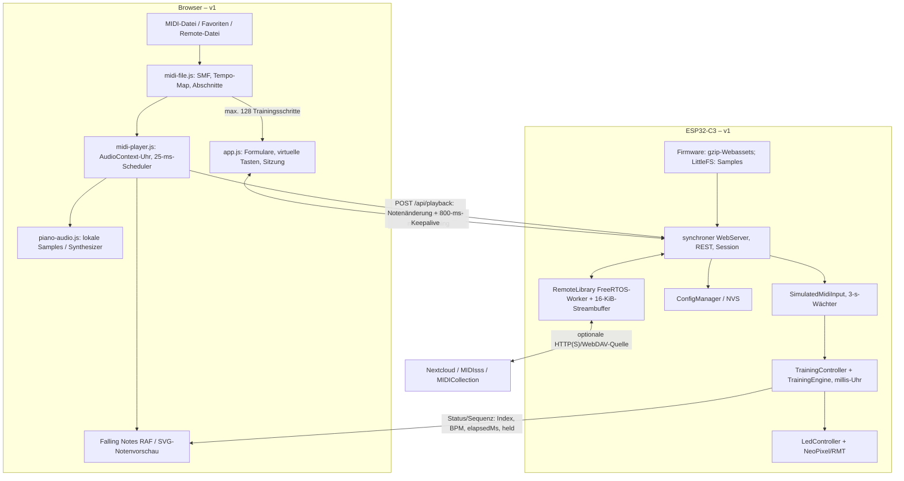
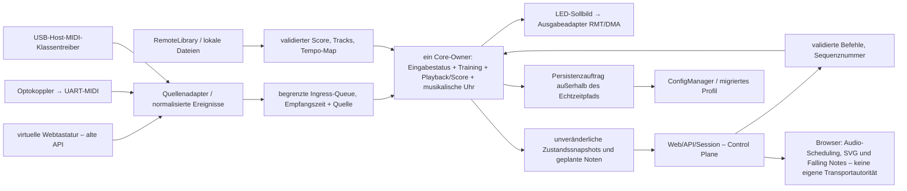

# PianoTrainer v2 – Architektur und Bestandsaufnahme

Stand: 1. November 2026. **Phase-0-Referenzinventar und Zielarchitektur. Phase 1 ist freigegeben; der minimale Softwareport ist in [V2_S3_PORT.md](V2_S3_PORT.md) dokumentiert. Die freigegebene [Phase-2-Vorbereitung](V2_MIDI_PREPARATION.md) implementiert gemeinsame Eingaben, DIN und einen isolierten USB-Probelauf. Weitergehender USB-Empfang sowie Phasen 3–4 sind offen.**

Verbindliche Referenz: **v1.15.1**, `6e8206f0dfab4b182a6550b6aa9f3f70d67e2457`. Arbeitsbranch: `develop/v2`. [Feature-Matrix](V2_FEATURE_PARITY.md), [Migration/Meilensteine](V2_MIGRATION_PLAN.md), [Testplan](V2_TEST_PLAN.md). Die gesonderte Freigabe für Phase 1 liegt mit „dnn los“ vor; der Entwicklungsstand ist `2.0.0-alpha.1`.

## 1. Repository und tatsächlicher Istzustand

103 versionierte Dateien am Referenzcommit, einschließlich drei versionierter C3-Downloadverzeichnisse. Generierte `.pio/`, `node_modules/`, Python-Caches und Sprach-`.gz` sind keine zusätzlichen Projektquellen. Es existiert keine `.github/workflows`-CI und keine projektweite `LICENSE`-Datei. Fremdasset-Quellen sind dagegen dokumentiert; daraus folgt noch keine geklärte Bausatz-Lizenzierung.

| Bereich | Tatsächlich untersuchte Bestandteile / Verantwortung |
|---|---|
| Boot und Board | `src/main.cpp`, `include/BoardProfile.h`: globale Objekte, bounded USB-Wartezeit, BOOT-Reset, serielle Diagnosen; hartes C3-Pinprofil |
| Lernkern | `TrainerLogic.h`, `MidiTypes.h`, `TrainingEngine.h`, `TrainingCatalog.h`, `LessonCatalog.h`, `LessonProgress.h`; Mapping, Validierung, 19 Vorlagen/20 Lektionen und Bewertungen |
| Lern-/LED-Adapter | `TrainingController.{h,cpp}`, `LedController.{h,cpp}`, `MidiInput.h`; Hardwareaufrufe und simulierte Eingabe, keine echte MIDI-Quelle |
| Gerätedaten | `ConfigManager.{h,cpp}`, `LibrarySettings.h`, `NetworkSettings.h`; Preferences, Legacy-/Profilmigration, Backupvalidatoren |
| Web und Sitzungen | `TrainerWebServer.{h,cpp}`, `ControlSession.h`, `LessonRoutes.cpp`, `LibraryRoutes.cpp`, `MaintenanceRoutes.cpp`; komplette Methodenliste in der Matrix |
| Netzwerkjobs | `WiFiManager.{h,cpp}`, `RemoteLibrary.{h,cpp}`; AP/STA/DNS/mDNS und getrennte HTTP/WebDAV-Workeraufgabe |
| Oberfläche | `data/index.html`, `style.css`, `app.js`: alle sieben Seiten, Formulare, Ereignisbindungen, Status-/Heartbeat-Pfade, Anzeigepräferenzen, Wiederherstellung und Updates |
| Browsermodule | `midi-file.js`, `midi-player.js`, `falling-notes.js`, `piano-audio.js`, `library.js`, `midi-favorites.js`, `nextcloud-upload.js`, `maintenance.js`, `i18n.js`; Audio, Darstellung, Quellen/Dateien und Persistenz |
| Daten und Assets | `data/i18n/{languages,de,en}.json`, lokale Samplebank/Quellenhinweise, Logo/Icons; `docs/images/*` einschließlich Funktionsschema und Kennzeichnung generierter Illustrationen |
| Build und Werkzeuge | `platformio.ini`, `partitions.csv`, `package{,-lock}.json`, alle neun `tools/*.py`: gzip, EmbeddedWeb, Update-/Releasepakete, Quellenhash für Samples, Icons und Changelog |
| Qualität und Historie | beide nativen Testsuiten, alle Node-Testdateien, Python-Werkzeugtests, `AGENTS.md`, README, TODO, TESTING, CHANGELOG, `docs/I18N.md`, historische Releasebeschreibung und drei `dist/v*/`-Anleitungen/Manifeste/Prüfsummen |

### Bestehende Abhängigkeiten

- PlatformIO `espressif32@6.10.0`, `esp32-c3-devkitm-1`, Arduino-ESP32 **2.0.17**, ESP-IDF **4.4.7** laut lokalem SDK-Header; C++17. `c3_supermini` und `native` sind die einzigen Umgebungen.
- `Adafruit NeoPixel@1.12.5`, `ArduinoJson@6.21.5`; WebServer, WiFi, HTTPClient, TLS/CA-Bundle, Preferences, LittleFS, DNS/mDNS, Update und FreeRTOS kommen aus dem SDK.
- Entwicklerwerkzeuge: Node, jsdom 26.1.0, fake-indexeddb 6.0.0, Prettier 3.6.2 und Unity/Python-unittest. Node ist keine Geräteabhängigkeit. Iconregenerierung benötigt librsvg/Pillow; Samples sind bereits lokal mit Quellenhinweis vorhanden.
- Keine verpflichtenden Laufzeit-CDNs. Nextcloud, MIDIsss und MIDICollection sind optionale Netzwerkquellen. Lokale Dateien, vorhandene Favoriten, Übungen, UI und Klang benötigen keinen Internetserver.

## 2. Aktuelle Datenflüsse



`main.loop()` ruft nacheinander WiFi, HTTP, simuliertes MIDI, Training und LED-Animationen auf, danach `delay(1)`. Netzwerkanfragen im synchronen Server sowie Flash-/NVS-Schreiben können diesen Aufrufer verzögern. Ein eigener Hintergrundjob für Remote-Dateien existiert bereits; er ist keine MIDI-Echtzeitaufgabe.

**Zwei Zeitautoritäten:** Dateiplayer/Audio folgen `AudioContext.currentTime`; die Lernengine folgt auf dem Gerät übergebenen `millis()`-Werten. Falling Notes liest jeweils die aktive Quelle. Die Player-LEDs werden über HTTP gespiegelt. Diese Architektur ist eine vorhandene Funktion, aber noch nicht die in v2 geforderte gemeinsame musikalische Zeitbasis. Wait-for-Note hält nur den Lernfortschritt, nicht bereits einen kompletten Begleitdateiplayer an.

`MidiEvent` besitzt heute ausschließlich `note`, `velocity`, `channel`, `on`. `TrainingEngine.held[128]` unterscheidet keine Quellen oder gleichnamigen Töne verschiedener Kanäle. Wiederholtes Note-On einer gehaltenen Taste wird nicht neu gewertet. Ein blindes Anstecken zweier Treiber würde daher Quellkonflikte und falsche Note-Offs ermöglichen.

## 3. Zielboard – belegt, angegeben und noch offen

Nutzerangabe vom 1. November 2026: **„ESP32-S3 DevC-1-N16R8-S3“**. Diese Bezeichnung wird nicht stillschweigend durch ein anderes Board ersetzt. Die nachgereichte Anbieterbeschreibung zu [Amazon B0GVJ5WMR1](https://www.amazon.de/dp/B0GVJ5WMR1) nennt **ESP32-S3-WROOM-1-N16R8 und zwei USB-C-Buchsen**. Das Board ist noch im Zulauf; diese Angaben sind keine eigene Sichtprüfung. Der Link war im Recherchewerkzeug nicht abrufbar. Für den MIDI-Anschluss ist ein **OTraki 5-poliger IN/OUT-USB-MIDI-Konverter** vorgesehen: USB-Host → Adapter → DIN-Keyboard. Exaktes Modell, USB-Deskriptoren, Class-Compliance, Strombedarf und Isolierung sind nicht nachgewiesen. Ein separater DIN-UART-Eingang ist damit nicht automatisch getestet.

| Merkmal | Phase-0-Ergebnis | Nachweis / nächster Schritt |
|---|---|---|
| S3 / DevKitC-artiges Board | Ziel durch Nutzer benannt | Hersteller, Revision und konkrete Beschriftung/Schaltplan vor Pinfreigabe festhalten |
| N16R8-Speicher | Für das offizielle **WROOM-1-N16R8-Modul** dokumentiert: 16 MB Quad-SPI-Flash, 8 MB Octal-PSRAM | [Espressif-Speichertabelle](https://docs.espressif.com/projects/arduino-esp32/en/latest/troubleshooting.html); tatsächliches Modul und erkannte Kapazitäten in Phase 1 prüfen, keine Messung behaupten |
| PlatformIO-Basisprofil | `esp32-s3-devkitc-1` beschreibt standardmäßig **N8 ohne PSRAM** | [PlatformIO-Profil](https://docs.platformio.org/en/latest/boards/espressif32/esp32-s3-devkitc-1.html); allein diese Board-ID wäre kein korrektes N16R8-Profil |
| Reservierte Pins | Modul-/Boardbelegung neu prüfen; bei Octal-Speicher GPIO35–37 nicht frei | [Espressif-DevKitC-1-Handbuch](https://documentation.espressif.com/esp-dev-kits/en/latest/esp32s3/esp32-s3-devkitc-1/user_guide_v1.1.html); nicht die C3-Allowlist kopieren |
| USB-Daten / Debug | S3 hat OTG und USB-Serial/JTAG, aber einen gemeinsamen internen PHY | [Espressif USB-PHY-Hinweis](https://docs.espressif.com/projects/esp-usb/en/latest/esp32s3/usb_host.html); Host und Debug nicht auf demselben internen PHY gleichzeitig voraussetzen |
| USB-Host-Versorgung | Kein Beleg für schaltbaren, strombegrenzten 5-V-Host-VBUS auf dem konkreten Board | Schaltplan, Adapter, Rückspeiseschutz und Strombedarf des Keyboards prüfen; USB-Buchse allein beweist keinen versorgbaren Hostport |
| LED-/DIN-/BOOT-/Debug-Pins | Noch keine verbindliche S3-Belegung | Konfliktmatrix gegen USB, UART-Bridge, Speicher, Strapping und Board-LED erstellen; vorhandene LED-Schaltung/Mapping logisch erhalten |
| Partitionierung | C3-Offsets sind keine S3-Vorgabe | Zwei OTA-Slots, NVS/otadata, optionale Samples/Dateien, Recoverypfad und tatsächliche Flashgröße dimensionieren; noch keine neue CSV |

Ein separater USB-UART-Debugpfad wäre bei Nutzung des internen OTG-PHY zweckmäßig, **falls** das konkrete Board eine geeignete Bridge besitzt. Alternativen: externes PHY oder getrennter Debugadapter. Keine eFuse-Änderungen als bequemen Standard vorsehen. Kein GPIO/PSRAM-/VBUS-Test wurde am S3 ausgeführt.

## 4. Wiederverwendung und notwendige Trennungen

| Komponente | Wiederverwenden | Gezielte Anpassung nach Freigabe |
|---|---|---|
| `TrainingEngine`, Kataloge, Bewertungsfunktionen | Zustände, IDs, Parameter, vorhandene Tests | Uhradapter, Quellaggregation und spätere ergänzende Hand-/Haltepolicy; bisherige Auswertung als Kompatibilitätsmodus |
| `TrainerLogic` | 128er Mapping, Offset/Reverse, Mehrfachzuordnung und Kanalfilter | Boardabhängige GPIO-Validierung über Profil einspeisen; Header ist heute indirekt an C3 gebunden |
| `TrainingController` | Vermittlung und Statusformat | Alle Zustandsänderungen unter einem Owner; kein direkter Zugriff mehr aus Netzwerk-/MIDI-Tasks |
| `LedController` | vollständige Effekt- und Farblogik, Ausgabepuffer/Preview | Treiberschnittstelle, Dirty-Frame-Erkennung, begrenztes Frame-Coalescing und ggf. asynchrones RMT/DMA |
| Web/API + `ConfigManager` | REST-Vertrag, Auth/Session, Profilvalidatoren, UI | S3-Capabilities/Updateprüfung und hardwarebewusste Migration; neue Core-Befehls-/Snapshotgrenze |
| `RemoteLibrary` | Ein-Job-Modell, Atomics, Backpressure, Replay/TLS und Limits | SDK-Portierung; nicht in MIDI-Task verschieben; Besitzregeln für Configsnapshots dokumentieren |
| Browser-SMF-Parser und Audio | Import, volle Wiedergabe, Samplebank/Fallback, Decodecache | Track-/Channel-/Tempo-Metadaten erhalten, Engineformat vereinbaren, Audio an Gerätezeit binden; kein Wegfall des lokalen Imports |
| Noten-/Falling-Notes-Ansichten | Canvas-Geometrie, Window-Index, RAF, SVG, Bedienung | Nur zeitliche/Track-Datenquelle ersetzen; keine Grafikframes vom ESP |
| Favoriten, Quellen, i18n, UI | bestehende Speicher-/Sprachformate und Menüs | Datenumzug bei Originwechsel, neue Texte/Capabilities additiv |
| Paket-/Releasewerkzeuge | deterministisches gzip, Paket-/ZIP-/Checksumtests | Target-/Board-/Layoutdaten aus Buildprofil statt hartem C3; C3-Artefakte unverändert archivieren |

## 5. Architekturentscheidungen vor Implementierung

Diese ADRs dokumentieren Alternativen und Risiken. Der bevorzugte Weg ist eine Empfehlung; die Umstellung ist noch nicht freigegeben.

| ADR | Alternativen | Empfehlung / Grund | Risiko und Entscheidungsgate |
|---|---|---|---|
| A01 Framework | bestehendes Arduino 2.0.17/IDF4.4.7; Arduino als IDF-Komponente; vollständiges IDF-Rewrite; anderer gepflegter PlatformIO-Stack | Zuerst kleinster S3-Port mit wiederverwendeter API/UI; danach isolierter SDK-/USB/RMT-Spike. Arduino als IDF-Komponente ist ein möglicher Weg zu neuerem Host-/DMA-Zugriff | Kein Big-Bang-Rewrite. Unterstützte, exakt gepinnte SDK-/Arduino-/PIO-Kombination muss mit Minimalbuild und benötigten APIs nachgewiesen werden. [Offizieller Komponentenweg](https://docs.espressif.com/projects/arduino-esp32/en/latest/esp-idf_component.html) ist kein Nachweis, dass beliebige Versionen kombinierbar sind |
| A02 USB-Host-Stack | ESP-IDF Host Library mit MIDI-Klassentreiber; TinyUSB-Host; externe Hosthardware | Vorzugsweise IDF-Host unter einem USB-Owner, wenn mit gewähltem SDK integrierbar; Treiberkandidat durch Enumerationstest auswählen | [IDF Host Library](https://docs.espressif.com/projects/esp-idf/en/v5.4/esp32s3/api-reference/peripherals/usb_host.html) erlaubt eigene Klassentreiber; [TinyUSB hat MIDI-Host-Code](https://github.com/hathach/tinyusb/blob/master/src/class/midi/midi_host.c), doch das beweist noch keinen S3-Hostcontroller-Support in unserem Build. Arduino-USB-MIDI-Device ist kein Host. Nicht zwei Stacks gleichzeitig denselben Controller besitzen lassen |
| A03 Echtzeitbesitz | gemeinsame Globals mit Mutex; ein Owner + Queues; alles im bisherigen Loop | Ein Core-Owner für Lernzustand/Timeline/LED-Sollbild, fixe Queues von MIDI und API, unveränderliche Snapshots zurück | Grundlegende Änderung erst nach P1-Parität. Keine HTTP-/NVS-/TLS-Aufrufe im zeitkritischen Owner; Antworten erst nach bestätigter Ausführung, Persistenzantwort erst nach Commit |
| A04 LED-Treiber | vorhandenes NeoPixel; IDF-RMT mit DMA; anderer Treiber | Zunächst NeoPixel als Referenz erhalten; RMT/DMA nur nach Protokoll-/Effektvergleich und Messung | Der gepinnte IDF4-Zweig von NeoPixel wartet in `esp.c` auf TX und richtet Kanäle erneut ein. „RMT“ bedeutet nicht automatisch nichtblockierend oder DMA. [IDF-RMT-DMA](https://docs.espressif.com/projects/esp-idf/en/v5.2/esp32s3/api-reference/peripherals/rmt.html) erfordert passende Chips/SDK-/Speicherfähigkeiten |
| A05 Musikalische Autorität | Browser als Master; S3 als Master; zwei frei laufende Uhren | S3-Master für v2, Browser interpoliert und rendert/schedult Audio anhand derselben Zustände | Browser-Master reicht für USB-Lernen ohne Browser nicht; zwei Uhren verursachen Drift. Browser-Scheduler aus v1 während Portierung erhalten, erst nach Syncabnahme ablösen |
| A06 UI-Transport | HTTP-Polling weiterverwenden; SSE; WebSocket | Bestehende REST-API erhalten; ein begrenzter, versionierter Zustand-/Eventstream nur wenn Messungen es rechtfertigen | WebSocket allein macht keine Echtzeitgarantie; Reconnect, Backpressure, Session/Auth und lokale Uhrkorrektur testen; keine neue Cloudpflicht |
| A07 Dateiablage | nur Browser-RAM wie v1; kompletter Score im S3-PSRAM; Flashdatei + Ereignisfenster | Browserimport erhalten; für S3-Master begrenztes binäres Scoreformat/Chunktransfer oder lokalen Parser prototypisieren, Tempo-Map gemeinsam nutzen | 2-MiB-Dateigröße ist kein RAM-Budget. 125.000 Noten zu z. B. 32 B wären ca. 4 MB allein für Noten; Index/Tempo/Tasks zusätzlich. Nicht komplette JSON-Dateien mehrfach im internen Heap halten |
| A08 C3-Erhalt | dauerhafte Doppelentwicklung; eingefrorene v1; Übergangs-Regression | v1.15.1-Tag und C3-Pakete einfrieren, Übergangsbuilds nutzen; S3 wird primär | Keine main-Änderung, kein C3-Host-Experiment. AGENTS-C3-Vorgabe in Phase 1 ausdrücklich für S3 ergänzen, nicht stillschweigend missachten |
| A09 OTA und Daten | C3-Pakete umetikettieren; target+board+layoutgebundene Pakete; kompletter Flashklon | Eigene S3-Hardwarekennung und Manifest-/Image-/Layoutprüfung, öffentliche v1-Backups semantisch migrieren | Details in Migrationsplan; kein Raw-NVS-/Flashklon und keine automatische Secret-Ausfuhr |

## 6. Vorgeschlagener v2-Datenfluss



### Gemeinsames MIDI-Ereignismodell – Entwurf

Festes Value-Objekt, mindestens `type`, `channel` (1–16), `note` (0–127), `velocity`, `receivedUs:uint64`, `sourceType`, `sourceId`, `sourceEpoch`, `sequence`. `sourceId` unterscheidet Geräte/USB-Kabel/virtuelle Sitzung. Trennung von Empfangszeit, musikalischem Zieltick und Zeitpunkt der tatsächlichen LED-Anforderung. Keine Strings/Heapallokation im Hotpath.

Adapter normalisieren Velocity-0-Note-On zu Note-Off. Ein zentrales Ledger verwaltet Quelle × Kanal × Ton, ergänzt Counts/Anschlagsgenerationen für wiederholte On-Ereignisse. Die Engine bekommt daraus einheitliche Ereignisse und einen definierten Haltezustand; kein separater DIN-/USB-Lernalgorithmus. Das Ledger schützt einen identischen DIN-Ton vor einem USB-Note-Off. Reset/Disconnect löscht nur die betroffene Quelle, ein explizites Panic darf alle löschen. Hardwarequellen übernehmen nicht den virtuellen 3-s-Heartbeat-Wächter.

DIN: 31.250 Baud, 8N1, entkoppelter UART-Ringbuffer; Status-/Running-Status-Parser, System-Realtime darf laufende Nachrichten nicht zerlegen, SysEx längenbegrenzt verwerfen/weiterreichen, fehlerhafte/abgeschnittene Daten resynchronisieren. UART-Overrun/Queueverlust zählen und einen kontrollierten Quellenreset auslösen, statt Note-Off unbemerkt zu verlieren. Eine stille DIN-Leitung beweist ohne Active Sensing keine Gerätetrennung. Optokopplerbeschaltung und 3,3-V-Ausgang nach konkret gewählten Bauteildaten prüfen; noch kein verbindlicher Schaltplan.

USB: zunächst nachweislich class-compliant USB-MIDI-1.0-Streaming mit geprüften Deskriptoren und Bulk-IN, CIN/Kabelnummer/Packetlänge validieren; mehrere Interfaces nicht pauschal als ein Keyboard behandeln. Unsupported Vendor-/UMP-only-Geräte klar melden. Enumeration, Abziehen während Transfers, Fehler/erneute Anmeldung und Gerätegeneration testen. MIDI 2.0, beliebige Hubs und jedes Herstellerprotokoll sind nicht automatisch Teil der ersten Kompatibilitätszusage. [USB-MIDI-1.0-Spezifikation](https://www.usb.org/sites/default/files/midi10.pdf) ist die Protokollreferenz.

### FreeRTOS-Aufteilung – noch keine festen Core-/Prioritätszahlen

MIDI-Treiber/Callbacks legen begrenzte Ereignisse ab; UART-RX und USB-Host-Daemon bleiben kurz und blockieren nur auf geeigneten Events. Der Core wartet auf Eingabe oder nächsten musikalischen Termin, verarbeitet begrenzte Batches und gibt ein LED-Sollbild aus. Netzwerk/Web und RemoteLibrary bleiben getrennt; Persistenz/Diagnose erhalten nur Snapshots/Aufträge. Preview-Frames können zusammengefasst werden; Note-Offs/Transportbefehle dürfen nicht still verloren gehen. Überfüllung, Core-Laufzeit und schlechteste Wartezeit müssen zählbar sein.

Die [IDF-FreeRTOS-Dokumentation](https://docs.espressif.com/projects/esp-idf/en/v5.4/esp32s3/api-reference/system/freertos_idf.html) beschreibt SMP sowie `CONFIG_FREERTOS_UNICORE`. In Phase 1 echte `sdkconfig`, Arduino-Loop-/Event-/WiFi-Affinität, Tickrate und Stack-Watermarks erfassen. Erst danach Core-/Prioritätszuordnung testen; „WiFi auf Core 0, MIDI auf Core 1“ ist keine ungeprüft einzubauende Regel. Keine breite Mutex-Sperre über HTTP/NVS/RMT-Wartezeiten und kein Serial-Logging pro Note.

## 7. Gemeinsame Zeitbasis und Synchronisationsentwurf

Die Transportuhr besitzt `transportId/epoch`, `revision`, monotone Gerätezeit in µs, Position in PPQN-Ticks, Tempo-Map, Tempo-Faktor, Laufzustand (`stopped`, `countin`, `playing`, `paused`, `waiting`, `completed`) und nächste sichere Effektivzeit. Tick↔Zeit-Konversion hält Tempoereignisse auch über Seek und Pause korrekt; Betrieb ohne Netzwerkrückmeldung bleibt auf dem S3 möglich.

Entwurf eines **neuen** versionierten Snapshots/Streams, noch keine bestehende API:

```json
{
  "protocol": 2,
  "transportId": "boot-and-song-epoch",
  "revision": 42,
  "deviceTimeUs": 128000000,
  "effectiveAtUs": 128100000,
  "positionTick": 9600,
  "ppqn": 480,
  "tempoUsPerQuarter": 500000,
  "tempoFactor": 1.0,
  "state": "playing",
  "practiceTracks": [0],
  "accompanimentTracks": [1],
  "held": [],
  "required": [60, 64, 67]
}
```

Der Browser ermittelt Gerätezeitoffset und Unsicherheit aus wiederholten Roundtrips (minimale RTT als guter Kandidat), ordnet diese seiner monotonen Performance-/Audiouhr zu und interpoliert **nur** zwischen bestätigten Zuständen. Notenbatches enthalten absoluten Tick, Dauer, Track, Kanal, Velocity, Handzuordnung und Epoch/Revision. Eine vereinbarte Planungsvorschau ermöglicht Audio-Scheduling ohne Note-für-Note-HTTP. Zahlenbereiche/JSON-µs bleiben im sicheren Integerbereich oder werden explizit kodiert.

Seek/Tempo/Pause werden serverseitig angenommen und mit `effectiveAtUs`/neuer Revision bestätigt. Browser verwirft ältere Revisionen, beendet überholte Stimmen und zeichnet sofort dieselbe Position. Eventbatches aus einer alten Datei/Quelle dürfen nach einem asynchronen Sampleload nicht neu starten. LED-Vorschau und Playback-LEDs werden lokal auf derselben Zeitachse terminiert; Live-MIDI-Feedback hat separat gemessene direkte Priorität. Browser-Rendering-/Audio-Vorlauf und Netzwerklatenz sind getrennt zu kompensieren, nicht im BPM versteckt.

Wait-for-Note friert die **musikalische Position** an der erforderlichen Stelle ein, während die monotone Geräteuhr weiterläuft. Akkord-/Haltepolicy ist konfigurierbar, das bisherige frische Anschlagen bleibt auswählbar. S3, Audio, Begleitspuren und Canvas übernehmen denselben `waiting`-Zustand. Bei Reconnect erfolgt vollständiger Snapshot statt Nachspielen alter Events; die Sitzungshoheit bleibt unabhängig davon erhalten. Hintergrundpause aus v1 wird ein global bestätigter Pausebefehl, kein nur lokal pausierter Audiokontext. Unzureichende Synchronisationsqualität muss sichtbar sein.

## 8. Speicher, Performance und konkrete Risiken

| Punkt | Referenzwert / Befund | Risiko / geplante Gegenmaßnahme |
|---|---|---|
| C3-App | Firmware 1.351.424 B, linkerbelegte Flashgröße 1.300.624 B, Slot 1.572.864 B; statischer RAM 51.324 B | Nicht verwechseln: Binärdatei, Linkerbelegung und dynamischer Heap. S3 neu vermessen; UI-Wachstum begrenzen |
| C3-Partitionen | NVS 0x5000, otadata 0x2000, zwei Apps à 0x180000, LittleFS 0xF0000 | N16R8 braucht eigenes geprüftes Layout. Nie nur Flashsize überschreiben und alte Installationsanleitung übernehmen |
| Dynamische Allokationen | JSON-Dokumente 8/16/24 KiB, Serialisierung in zusätzliche Strings, TLS, Library-Workerstack 8192 und 16-KiB-Streambuffer + 4-KiB-Replay | Gleichzeitigkeit und größten freien Block messen; PSRAM nicht als Ersatz für internen Heap/DMA-RAM betrachten |
| Lernmodell | 128 Schritte, 8 Töne je Schritt; `held[128]` | Erhöhung auf ≥10 Akkordtöne betrifft Parser, HTTP-Limit, Validierung, Speicher und Tests gleichzeitig |
| LED-Render | Schleifen über LED-Anzahl × 128 Noten; wiederholte `show()` und synchron wartender v1-RMT-Zweig | Dirty-Frames, Zuordnungsindex und nichtblockierende Ausgabe erst gegen vorhandene Effekte prüfen |
| Physische LED-Dauer | Rechnerisch bei 800 kHz und 24 Bit ca. 30 µs/LED: 60 ≈1,8 ms; 300 ≈9 ms, jeweils plus streifenspezifischer Resetzeit | Keine gemessenen Latenzen; Requestlatenz, Treiberrückkehr und tatsächliches Latch getrennt erfassen |
| MIDI-Drahtzeit | Rechnerisch 8N1 bei 31.250 Baud: 320 µs/Byte, 3-Byte-Nachricht ≈0,96 ms | Zeit vor vollständigem Empfang ist kein Queue-/Softwareproblem; nicht in interne P95 hineinmogeln |
| Browser | bis 2-MiB-Datei plus Parser-/Indexkopien, 32-MiB-Favoriten, Audio-Decode pro Kontext; RAF und bisherige Status-/SVG-Arbeit | iOS-Speicher und Framezeiten wirklich messen; keine garantierten 60 FPS aus Desktop-Build ableiten |
| SDK-Wechsel | IDF4-RMT vs. IDF5-RMT, USB/Serial, TLS-Bundle-Symbol, LittleFS/Update/Preferences/WiFi-Eventtypen | Kompatibilitätsspike und getrennte, rücknehmbare Commits statt gleichzeitigem Core-/SDK-/UI-Rewrite |
| Physische Schnittstellen | Host-VBUS, Rückspeisung, Optokoppler, Reservierungen unbestätigt | Hardwareprofil und reale Belastungstests sind vor Phasenfreigaben erforderlich |
| Persistenz/OTA | NVS-Flashschreiben kann Echtzeit stören; FS hat eine Kopie, Post-Boot-Rollback fehlt | Fortschritt gebündelt außerhalb Hotpath; Stromausfall-/Bootfehlerpfad testen und Risiko explizit entscheiden |

### Messentwurf

Optionale Diagnose mit festen Zählern/Histogramm oder begrenztem Ringbuffer: Events/s, Queuefüllung/High-Watermark, Verluste/Fehler je Quelle, `receivedUs → ledRequestUs`, Treiberdauer/TX-Completion, Durchschnitt/P95/P99/Maximum, freier/minimaler interner Heap, größter Block, PSRAM-Nutzung, Task-Stack und CPU-Anteile nur bei tatsächlich aktiviertem Runtime-Stats-Support. Ohne Support „nicht verfügbar“, niemals erfundene Auslastung.

Ziel: **P95 intern <10 ms, möglichst Maximum <20 ms**, Nullverluste bei vereinbarter Normalbelastung. Start des Intervalls ist vollständiger interner Nachrichtenempfang; zusätzliche Byte-/USB-/Optokoppler-/LED-/Browserlatenz separat ausweisen. Der Testplan definiert Last, Dauer und Rohbelege. Bis zur echten S3-Messung bleiben alle S3-Messfelder „nicht gemessen“.

## 9. Adaptive Begleitung – ausschließlich Voruntersuchung

Spätere Eingabe könnte mit einem begrenzten Scorefenster über Onset-/Pitch-Muster verglichen werden. Kandidaten sind regelbasierter Beattracker, Online-DTW oder probabilistischer Score-Follower. Mehrdeutige Wiederholungen, falsche/fehlende Töne, Rubato und Rechenbudget erfordern Konfidenz und einen manuellen Wiederanlauf; eine falsche Position darf keine unkontrollierten Temposprünge auslösen. Ein zukünftiges `FollowerProposal {position, rate, confidence}` würde **nur** Vorschläge an den Transport-Owner liefern. Die eigentliche Uhr bleibt eindeutig. Keine Implementierung vor stabilen Phasen 2–4 und separatem, freigegebenem Messdatensatz.

## 10. Offene Entscheidungen vor Phase 1/2

1. Hersteller/Revision/Schaltplan des genannten DevC-Boards, Modulaufdruck und erkannte Flash-/PSRAM-Kapazität; das Zielmodell ist genannt, diese Einzelheiten sind noch unbestätigt.
2. Welche Buchse führt OTG, welche Debug/UART? Wie werden 5-V-Host-VBUS, Überstrom und Rückspeisung behandelt?
3. Konkretes Testkeyboard: Modell, class-compliant Modus, VID/PID/Deskriptoren, Strombedarf und Self-/Bus-Power; DIN-OUT verfügbar?
4. Freie Pins für LED-Daten, DIN-RX und optionalen VBUS-Schalter; vorhandene Pegelwandler-/Netzteil-/Optokopplerschaltung.
5. Gepinnter Framework-/Hoststack nach Spike; Partitionierungsbudget und Umgang mit fehlendem/fehlerhaftem PSRAM.
6. Quellen gleichzeitig oder auswählbar? Default für gehaltene Akkorde, Sustain/Active Sensing und Wiederanschläge festlegen, ohne v1-Standard zu verlieren.
7. Browserdatenumzug bei neuer Adresse sowie Secret-Neueingabe beim physischen Gerätewechsel; keine unerlaubte Passwortausfuhr.
8. Vor einer Bausatzfreigabe: Projektlizenz, Quellen-/Attributionsbestand, reproduzierbare Stückliste/Schaltpläne und eigener Hardwareprüfstand. Der Phase-0-Status ist keine Produktfreigabe.

Die angegebenen SDK-Dokumentationsversionen erläutern Alternativen; sie sind **keine** Auswahl einer neuen Buildversion. Boarddaten sind gegen Herstellerquellen und anschließend gegen das echte Gerät zu prüfen. Alle weiteren Schritte und Abnahmebedingungen stehen im [Migrationsplan](V2_MIGRATION_PLAN.md).

## Phase-2-Entscheidungen nach Freigabe

- **A02 konkretisiert:** ESP-IDF-4.4.7-Hostbibliothek/Client-APIs sind im bestehenden S3-SDK vorhanden und im isolierten `s3_usb_probe` erfolgreich gelinkt. Kein Stack-/SDK-Wechsel in dieser Vorbereitung. Probelauf nur Enumeration, keine MIDI-Transfers oder Kompatibilitätszusage. Grenzen und Alternativen siehe [Vorbereitungsbericht](V2_MIDI_PREPARATION.md).
- **Eingabebesitz:** Ein Arduino-Loop verarbeitet Web, begrenzte UART-Lesevorgänge und den Router. Es gibt in dieser Phase noch keine MIDI-Worker, die direkt Lern-/LED-Daten verändern. USB-Probe-Daemon bearbeitet nur SDK-Bibliotheksereignisse; Client-Callbacks/Status bleiben im Loop, sein gemeinsamer Fehlerzähler ist atomar. MIDI-Queue/Workertrennung erst bei tatsächlichen USB-Transfers bzw. Phase 3.
- **Quellenauswahl:** Laufzeitwahl Web/DIN, Default Web, keine neuen NVS-Felder. Gleichzeitige physische Quellen bleiben gesperrt, obwohl das portable Ledger bereits Quellen/Kanäle unabhängig hält. Das vermeidet eine ungeprüfte Persistenz-/Hardwareänderung. Erneute Auswahl/Stop dient bei DIN-Geräten ohne Active Sensing zur bewussten Notenfreigabe.
- **Kompatibilität:** Die vorhandene Lernengine und ihre musikalische Uhr bleiben erhalten. Der Timestamp ist die Parser-/Loop-Empfangszeit, keine gemessene Leitungs-/LED-Latenz; P95/P99 sind weiterhin nicht verfügbar.
